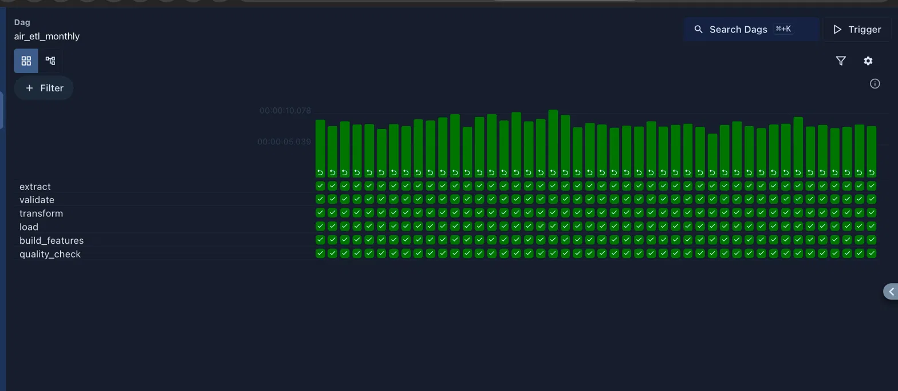
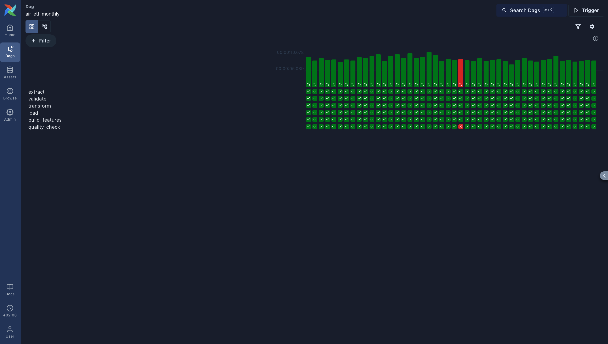
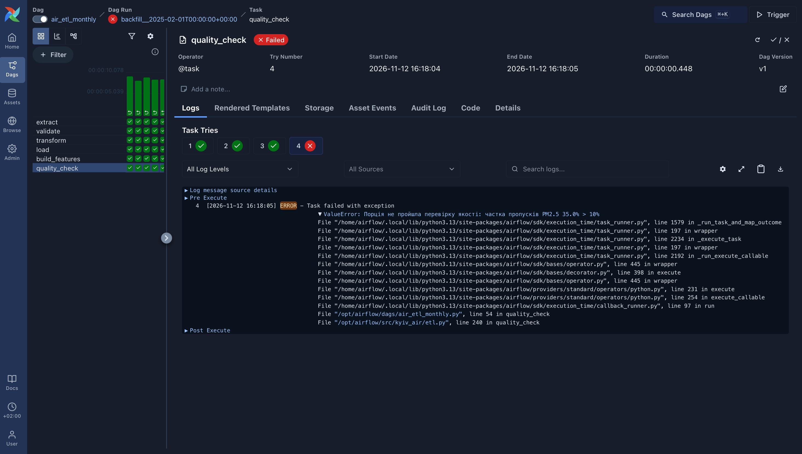
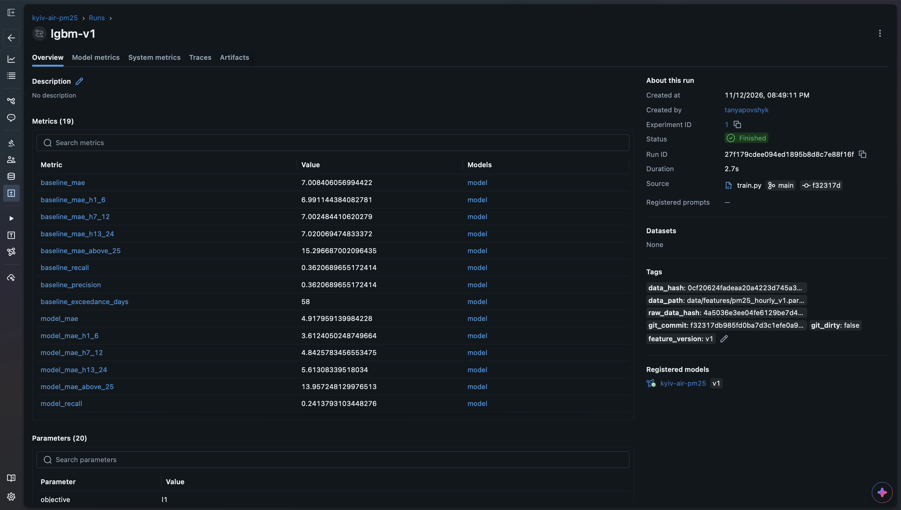
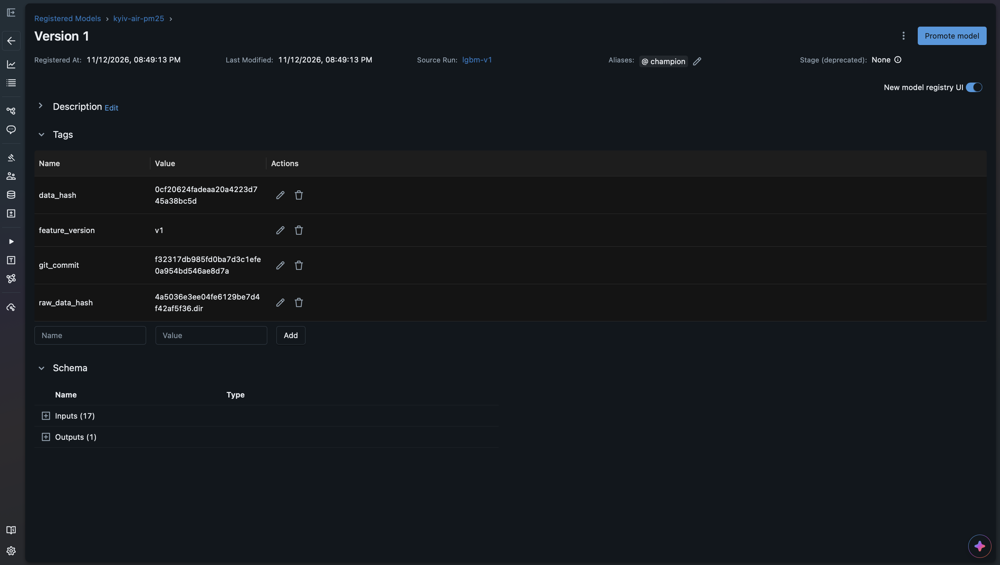
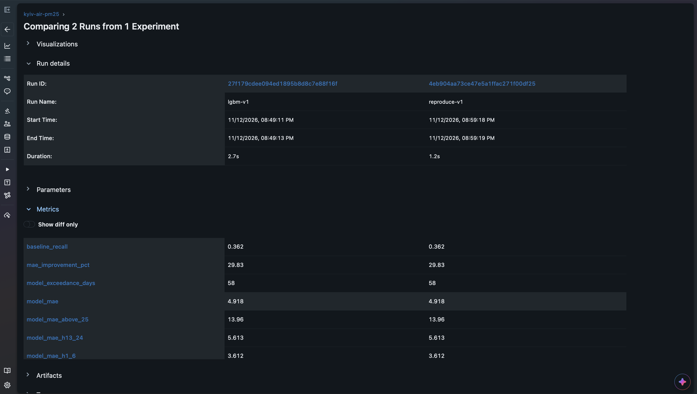

# Kyiv Air Forecast

Прогноз концентрації PM2.5 на 24 години вперед для 10 районів Києва. Навчальний проєкт курсу MLOps (KSE).

## Проблема

Мешканці Києва дізнаються про забруднене повітря лише тоді, коли воно вже забруднене: наявні мапи показують поточний рівень, а не наступну добу.
Система щогодини прогнозує концентрацію PM2.5 на 24 години вперед для кожного району міста на основі погодинних даних сенсорів SaveEcoBot і погоди.
Прогноз порівнюється з нормативами ВООЗ і ЄС, які зберігаються в конфігурації окремо від моделі, тож зміна нормативу не потребує перенавчання.
Якість повітря має сезонність, а сенсори відмовляють, тому модель регулярно перенавчається на нових місячних порціях даних, а система стежить за дрейфом і свіжістю даних.
Мета — щоб щонайменше 80% діб із перевищенням добового нормативу супроводжувалися попередженням, виданим заздалегідь.

Повний опис системи: [`docs/design.md`](docs/design.md).

## Таблиця зрілості системи

Кожен рядок — властивість системи і доказ, який рецензент може перевірити з репозиторію. Таблиця доповнюється в кожній лабораторній.

| Властивість | Доказ, який перевіряє рецензент | Додано |
|---|---|---|
| Репозиторій відтворюється з чистого клону | CI зелений; `make setup` і `make lint` успішно виконуються на свіжому клоні | Lab 1 |
| Проєктний документ існує й актуальний | [`docs/design.md`](docs/design.md) відповідає шаблону, кожен розділ заповнено або позначено як припущення | Lab 1 |
| Дані версіоновано | `uv run dvc pull` на чистому клоні отримує сирі дані з контрольними сумами, наведеними в розділі [«Дані»](#дані-dvc) | Lab 2 |
| Пайплайн ідемпотентний | Той самий місяць, запущений двічі, дає однакову кількість рядків — обидва підрахунки в розділі [«Ідемпотентність»](#ідемпотентність) | Lab 2 |
| Є ворота якості | Навмисно зіпсована порція валить запуск — [знімок червоної задачі](docs/img/airflow_quality_failed.png) і [лог](docs/img/airflow_quality_failed_log.png) | Lab 2 |
| Експерименти відстежуються | Кожен запуск у MLflow має параметри, метрики, `data_hash` і `git_commit` — [знімок запуску](docs/img/mlflow_run.png) | Lab 2 |
| Модель зареєстровано з походженням | Версія `kyiv-air-pm25` v1 з тегами даних і коду та позначкою `champion` ([знімок](docs/img/mlflow_registry.png)); `make reproduce` відтворює її однією командою ([порівняння](docs/img/mlflow_reproduce.png)) | Lab 2 |

## Швидкий старт

Потрібні: [uv](https://docs.astral.sh/uv/), `make`, Docker Desktop (≥ 6 ГБ пам'яті), Python 3.12 (uv встановить сам).

```bash
git clone https://github.com/tpovshyk/mlops_kyiv-air-forecast.git
cd mlops_kyiv-air-forecast
make setup                 # закріплене середовище з uv.lock
make lint                  # лінтер ruff
cp .env.example .env       # і впиши свої паролі
make up                    # PostgreSQL, MinIO, MLflow, Airflow
make ps                    # усі сервіси мають бути Up
```

| Сервіс | Адреса | Навіщо |
|---|---|---|
| Airflow 3.3.1 | http://localhost:8080 | DAG `air_etl_monthly` |
| MLflow 3.16.1 | http://localhost:5050 | запуски й реєстр моделей |
| MinIO (консоль) | http://localhost:9001 | бакети `dvc` і `mlflow` (вхід — `MINIO_ROOT_USER` / `MINIO_ROOT_PASSWORD` з `.env`) |
| PostgreSQL 16 | localhost:5432 | бази `warehouse`, `airflow`, `mlflow` |

Повний ланцюжок Lab 2 після `make up`:

```bash
uv run dvc pull                                   # 1. дані (див. «Дані»)
make backfill FROM=2023-01-01 TO=2026-10-31       # 2. ETL усіх місяців
make snapshot                                     # 3. знімок ознак → DVC
make train                                        # 4. базова модель vs LightGBM → MLflow
make register                                     # 5. те саме + реєстрація champion (лише з закоміченого коду)
make reproduce                                    # 6. відтворення champion
```

## Дані (DVC)

**Remote:** S3-сумісне сховище **MinIO** (образ `pgsty/silo`) з `docker-compose.yml`, бакет `dvc`, endpoint `http://localhost:9000`. Налаштування remote закомічено в [`.dvc/config`](.dvc/config); ключі доступу — ні.

**Як отримати дані на чистому клоні** (сервіси вже запущено `make up`):

```bash
uv run dvc remote modify --local minio access_key_id     <MINIO_ROOT_USER з .env>
uv run dvc remote modify --local minio secret_access_key <MINIO_ROOT_PASSWORD з .env>
uv run dvc pull
uv run dvc status        # очікується: Data and pipelines are up to date.
md5 data/raw/districts/*.csv      # на Linux: md5sum
```

Ключі записуються в `.dvc/config.local`, який DVC не комітить.

**Що надійде.** Сирі CSV — увесь набір, 10 файлів, 44.5 МБ (менше за 200 МБ, тому без вибірки). DVC-хеш папки `data/raw/districts`: `4a5036e3ee04fe6129be7d4f42af5f36.dir`.

| Файл | md5 |
|---|---|
| `saveecobot_city_district_95_hourly.csv` | `f3b430348f639c34353742ef284e0786` |
| `saveecobot_city_district_96_hourly.csv` | `4f4d9d9d71efc13fb9cfab4c67a0347e` |
| `saveecobot_city_district_97_hourly.csv` | `edc71f6d2fe2f7fcf11a2d7ade2598ee` |
| `saveecobot_city_district_98_hourly.csv` | `9cea2743d637d9253f82237d3e0a3c89` |
| `saveecobot_city_district_99_hourly.csv` | `7f2a670546187ba90c6bbf4f3087a5a1` |
| `saveecobot_city_district_100_hourly.csv` | `23abb76c38cec1f5ababda3e35777d29` |
| `saveecobot_city_district_101_hourly.csv` | `daec201094e2f00798fa393796655f24` |
| `saveecobot_city_district_102_hourly.csv` | `960c718aff63061bb0516a3cd1d3b3bc` |
| `saveecobot_city_district_103_hourly.csv` | `28b9752c4ed07480d78ed32ba74b6a3d` |
| `saveecobot_city_district_104_hourly.csv` | `c1142a58890fa13ecfc650ea624816e3` |

Також під DVC: знімок ознак `data/features/pm25_hourly_v1.parquet` (хеш `0cf20624fadeaa20a4223d745a38bc5d`, 336 000 рядків) і корпус документів `data/corpus/` (хеш `a07f3506f9755ebe5072c182ee45ddb7.dir`).

**Обмеження.** Remote — MinIO в Docker на ноутбуці автора, тож `dvc pull` працює там, де дані було завантажено командою `dvc push` (на захисті — чистий клон на тому самому ноутбуці). На іншому комп'ютері MinIO порожній: CSV треба завантажити зі сторінок районів [SaveEcoBot](https://www.saveecobot.com/) у `data/raw/districts/`, а потім виконати `uv run dvc add data/raw/districts && uv run dvc push`. Хеш тоді буде інший, бо джерело щогодини дописує нові дані.

**Атрибуція.** Дані про якість повітря надано [SaveEcoBot](https://www.saveecobot.com/) за ліцензією [CC BY 4.0](https://creativecommons.org/licenses/by/4.0/). Погодні дані (з Lab 4) — [Open-Meteo](https://open-meteo.com/), CC BY 4.0. Корпус нормативних документів: перелік і джерела в [`configs/corpus.yaml`](configs/corpus.yaml). Відповідність ID районів назвам: [`configs/districts.yaml`](configs/districts.yaml).

## ETL: DAG `air_etl_monthly`



Шість задач: `extract → validate → transform → load → build_features → quality_check`. Код — [`dags/air_etl_monthly.py`](dags/air_etl_monthly.py) і [`src/kyiv_air/etl.py`](src/kyiv_air/etl.py).

| Задача | Що робить | Куди пише |
|---|---|---|
| `extract` | Бере з CSV рядки інтервалу запуску | `raw.saveecobot_hourly` (значення як текст) |
| `validate` | pandera: колонки, `phenomenon ∈ {pm25, aqi}`, числа, дати, відомі ID районів | — |
| `transform` | Правила очищення, повна сітка «район × година» | проміжний файл |
| `load` | Очищені рядки | `dwh.pm25_hourly` |
| `build_features` | Лаги, ковзні середні, `city_mean`; бере 7 діб історії до інтервалу | `features.pm25_hourly` (`feature_version = 'v1'`) |
| `quality_check` | Ворота якості (нижче) | — |

**Порція — календарний місяць, і вона береться з інтервалу запуску, а не з поточного часу.** В Airflow 3 розклад `@monthly` сам по собі не створює інтервалу (`data_interval_start` = `data_interval_end`), тому ми **явно оголосили інтервал**:

```python
schedule=CronDataIntervalTimetable("@monthly", timezone="UTC")
```

Кожна задача працює з `[data_interval_start, data_interval_end)`. Запуск з назвою `…2025-02-01…` обробляє січень 2025: в Airflow 3 запуск отримує дату **кінця** інтервалу (`run_after`), а дані — за інтервал, що закінчився.

Перевірити, що запуск за конкретний місяць пише рядки лише цього місяця:

```bash
make counts MONTH=2025-01-01
```

### Ідемпотентність

Кожен запис у таблицю — це видалення рядків інтервалу й вставка нових в одній транзакції. Рядок із задачі `load`:

```sql
DELETE FROM dwh.pm25_hourly WHERE ts >= %(s)s AND ts < %(e)s
```

(у `raw` — `WHERE batch_start = %(s)s`, у `features` — так само за інтервалом і версією.)

Січень 2025 запущено двічі (`make counts MONTH=2025-01-01` після кожного запуску):

| Шар | Запуск 1 | Запуск 2 |
|---|---|---|
| `raw.saveecobot_hourly` | 14880 | 14880 |
| `dwh.pm25_hourly` | 7440 | 7440 |
| `features.pm25_hourly` | 7440 | 7440 |

7440 = 10 районів × 744 години січня; у сирому шарі вдвічі більше, бо кожна година має два рядки (`pm25` і `aqi`).

### Ворота якості

`quality_check` валить запуск, якщо в порції неправильна кількість рядків, є повтори «район × година», пропусків PM2.5 понад 10%, значення поза 0–1000 мкг/м³, останній вимір старший за 6 год до кінця інтервалу або рядків ознак не стільки, скільки очищених.

**Як перевірено.** DAG має параметр `inject_bad_batch` (за замовчуванням `false`). З ним `extract` навмисно псує порцію: стирає 30% значень PM2.5 і ще 5% замінює на −50 (функція `corrupt` у [`src/kyiv_air/transforms.py`](src/kyiv_air/transforms.py)). Запуск січня 2025 з цим параметром:

```bash
docker compose exec airflow airflow backfill create --dag-id air_etl_monthly \
  --from-date 2025-01-01 --to-date 2025-01-31 --dag-run-conf '{"inject_bad_batch": true}'
```

Від'ємні значення правило очищення перетворює на пропуски, тож частка пропусків стає 35%, і `quality_check` падає з повідомленням:

```
Порція не пройшла перевірку якості: частка пропусків PM2.5 35.0% > 10%
```





**Як відновити порцію.** Параметри запуску (`conf`) зберігаються в самому запуску, тому повторити той самий червоний запуск означає знову зіпсувати дані. Треба видалити запуск в інтерфейсі Airflow (Runs → Delete) і запустити місяць заново без параметра. Після цього частка пропусків у січні 2025 — 0.0%.

**Правила очищення** і скільки рядків вони зачепили за всі 46 порцій (`make cleaning-stats`): PM2.5 = 0 при AQI > 0 → пропуск — 196 рядків; відсутні години додано як пропуски — 1 077; повторів годин і значень поза діапазоном немає. Деталі — [`docs/design.md`, розділ 5.2](docs/design.md#52-data).

## Модель і MLflow

Навчання читає не базу, а **знімок таблиці ознак** у Parquet під DVC (`make snapshot`): так хеш даних однозначно визначає, на чому навчено модель.

**Поділ за часом:** навчання — моменти прогнозу з 2023-01-08, цілі до 2025-09-24; 7 діб проміжку; відкладений період — жовтень–грудень 2025. Обґрунтування — [`docs/design.md`, розділ 5.4](docs/design.md#54-experimentation-and-validation).

**Базова модель** — правило «вчора о цій годині» (PM2.5 о t+h−24). **Модель** — LightGBM, одна на всі райони й горизонти 1–24 год, втрати L1. Обидві — на тих самих рядках відкладеного періоду:

| Метрика | Базова модель | LightGBM |
|---|---|---|
| **MAE, мкг/м³** | **7.008** | **4.918** |
| MAE, горизонт 1–6 год | 6.991 | 3.612 |
| MAE, горизонт 7–12 год | 7.002 | 4.843 |
| MAE, горизонт 13–24 год | 7.020 | 5.613 |
| MAE, години з PM2.5 > 25 | 15.297 | 13.957 |
| Recall попереджень (доба > 25 мкг/м³) | 0.362 | 0.241 |
| Precision попереджень | 0.362 | 0.700 |

LightGBM краща за основною метрикою на 29.8%. **Але чесно:** за recall попереджень модель гірша за правило. Втрати L1 тягнуть прогноз до медіани, тому модель занижує піки й рідше перетинає поріг 25 мкг/м³. Налаштування порогу — у Lab 4 (розбір — [розділ 7.2](docs/design.md#72-experiment-results)).

**Що логує кожен запуск:** параметри, 19 метрик, теги `data_hash` (DVC-хеш знімка), `raw_data_hash`, `git_commit`, `git_dirty`, `feature_version`, модель у рідному форматі LightGBM. MLflow зберігає метадані в PostgreSQL (база `mlflow`), а артефакти — в MinIO (бакет `mlflow`).



**Реєстр.** `make register` навчає модель і реєструє її як `kyiv-air-pm25`, але лише якщо код закомічено. Версія отримує теги `data_hash`, `git_commit`, `raw_data_hash`, `feature_version` і позначку **`champion`**, за якою її завантажуватиме Lab 4 (`models:/kyiv-air-pm25@champion`).



### Відтворення однією командою

```bash
make reproduce                # версія з позначкою champion
make reproduce VERSION=1      # або конкретна версія
```

Скрипт [`src/kyiv_air/reproduce.py`](src/kyiv_air/reproduce.py) читає з реєстру `git_commit` і `data_hash`, відновлює код коміту в тимчасовій папці (`git worktree`), перевіряє, що `.dvc`-файл цього коміту має той самий хеш, завантажує знімок (`dvc pull`), навчає заново й логує запуск `reproduce-v<N>`. **Допуск: MAE відрізняється від оригіналу не більше ніж на 1% (відносно).** Навчання детерміноване, тож на тій самій машині різниця 0.00%; допуск покриває інший процесор чи збірку бібліотек.

```
PASS: MAE оригіналу 4.9180, відтворено 4.9180, різниця 0.00% (допуск 1%)
```



## Структура репозиторію

```
configs/              довідники (райони, корпус)
dags/                 DAG Airflow air_etl_monthly
data/                 дані під DVC (у Git — лише файли .dvc)
docker/               Dockerfile для Airflow і MLflow, init.sql для PostgreSQL
docker-compose.yml    PostgreSQL, MinIO, MLflow, Airflow
docs/design.md        проєктний документ з діаграмами
docs/img/             знімки для README
scripts/counts.sql    кількість рядків порції в кожному шарі
src/kyiv_air/         ETL, ознаки, навчання, відтворення
```

## Ліцензія

Код і документація — [MIT](LICENSE). Дані належать їхнім власникам і поширюються за їхніми ліцензіями (див. «Атрибуція»).
