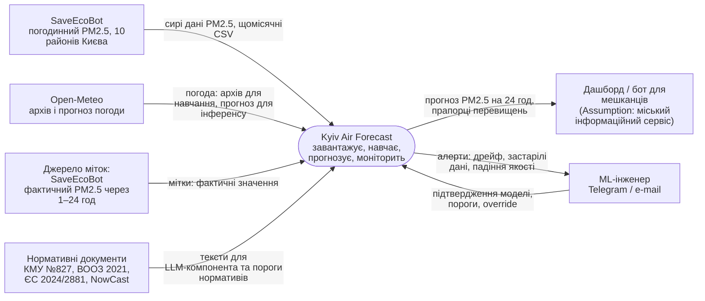
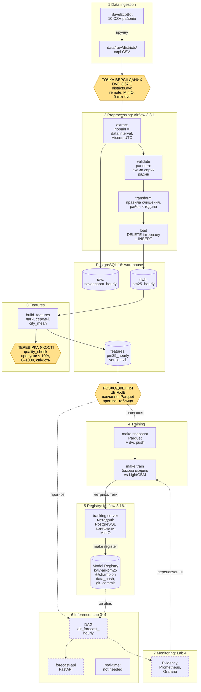
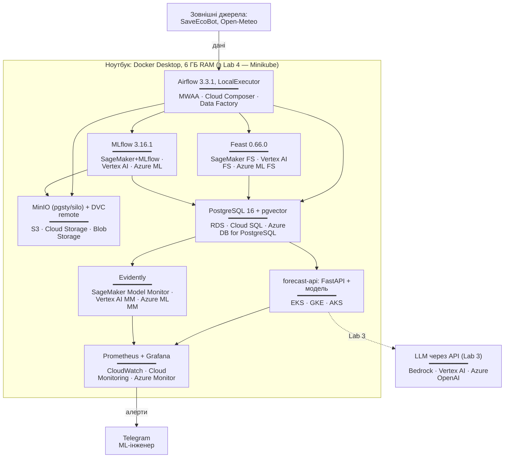

# Kyiv Air Forecast — Design Document

Прогноз концентрації PM2.5 на 24 години вперед для 10 районів Києва.
Документ ведеться за шаблоном ml-design-docs; нумерація розділів незмінна, бо наступні лабораторні посилаються на номери.

---

## 1 Overview

Мешканці Києва дізнаються про забруднене повітря лише тоді, коли воно вже забруднене: наявні мапи показують поточний рівень, але не наступну добу. Система щогодини прогнозує концентрацію PM2.5 на 24 години вперед для кожного з 10 районів міста на основі погодинної історії сенсорів SaveEcoBot і погодних даних. Прогноз порівнюється з нормативами ВООЗ і ЄС, які зберігаються в конфігурації окремо від моделі, тож зміна нормативу не потребує перенавчання. Бажаний результат: щонайменше 80% діб із перевищенням добового нормативу супроводжуються попередженням, виданим заздалегідь.

## 2 Motivation

**Хто споживає прогнози.** Мешканці районів через дашборд або бот із попередженнями (*Assumption:* реального замовника немає; споживачем вважаємо міський інформаційний сервіс на кшталт бота чи дашборда). Найбільше прогноз потрібен чутливим групам: людям з астмою, літнім людям, батькам малих дітей, тим, хто займається спортом надворі.

**Як часто.** Прогноз оновлюється щогодини; споживач читає його будь-коли протягом доби.

**Що буде, якщо прогноз хибний.**
- *Пропущене перевищення* (хибно негативний результат): людина планує прогулянку чи пробіжку на добу з брудним повітрям. Це найдорожча помилка.
- *Хибна тривога* (хибно позитивний результат): люди звикають ігнорувати попередження, і система втрачає довіру.

**Чому система, а не ноутбук.**
- Дані надходять безперервно, а якість повітря має сезонність (опалювальний сезон), тож модель старіє і потребує регулярного перенавчання.
- Сенсори відмовляють і зникають, тому потрібні автоматичні перевірки якості даних і моніторинг.
- Нормативи змінюються (директива ЄС 2024/2881 посилює ліміти з 2030 року), і система має реагувати без ручного втручання в модель.
- Прогноз потрібен щогодини автоматично, а не тоді, коли хтось запустить ноутбук.

## 3 Success metrics

Три рівні метрик тримаються окремо.

| Рівень | Метрика | Ціль | Тип |
|---|---|---|---|
| Бізнесова | Recall попереджень про добу з перевищенням 25 мкг/м³ (добове середнє, норматив ЄС) | ≥ 0.80 при precision ≥ 0.60 | satisficing |
| Модельна | MAE прогнозу PM2.5 (мкг/м³) по всіх районах і горизонтах 1–24 год на відкладеному періоді | щонайменше на 15% нижча за MAE базової моделі | optimizing |
| Системна | Свіжість: прогноз на годину H готовий не пізніше ніж о H:15 | ≥ 99% годин | satisficing |
| Системна | Затримка API, p95 | ≤ 300 мс | satisficing |

*Assumption:* цільові значення встановлено без реального замовника. Після першого навчання (Lab 2, розділ 7.2) модельну ціль досягнуто (MAE на 29.8% нижча за базову), а бізнесову — ні: recall попереджень 0.24 при precision 0.70. Ціль recall ≥ 0.80 не знижуємо; поріг попередження буде налаштовано в Lab 4 (розділ 7.2, «Що далі»).

**Як рахується бізнесова метрика.** «Доба з перевищенням» — календарна доба, фактичне середнє PM2.5 за яку в районі перевищує 25 мкг/м³. «Попередження» — прогноз середнього на наступну добу, що перевищує той самий поріг. Recall = частка діб із перевищенням, для яких попередження було видано.

## 4 Requirements and constraints

### Функціональні вимоги

| Що | Опис |
|---|---|
| Вхідні дані | Погодинний PM2.5 для 10 районів Києва (SaveEcoBot); погода — температура, вологість, швидкість вітру (Open-Meteo); пороги нормативів (`configs/thresholds.yaml`) |
| Пакетна задача | Щогодини: завантажити нові дані → перевірити якість → побудувати ознаки → спрогнозувати 24 значення × 10 районів → записати в PostgreSQL |
| API | `GET /forecast?district=<slug>` — 24 погодинні значення, середнє за добу, прапорці перевищення для кожного нормативу, час генерації, версія моделі; `GET /health` — стан сервісу |
| Хто викликає | Дашборд або бот (*Assumption*, див. розділ 2) |
| Перенавчання | Щомісяця, коли надходить нова порція даних, або за алертом дрейфу |

### Нефункціональні вимоги

| Категорія | Вимога |
|---|---|
| Свіжість | Прогноз на годину H готовий до H:15. Якщо останні вхідні дані старші за 2 год, прогноз позначається як застарілий (`stale=true`). |
| Затримка і пропускна здатність | API: p95 ≤ 300 мс при навантаженні до 10 запитів/с (*Assumption:* один споживач). Пакетна задача: ≤ 10 хв на 240 прогнозів. |
| Доступність і запасний варіант | ≥ 99% під час демонстрації. Якщо модель недоступна, API повертає прогноз базової моделі з прапорцем `fallback=true`. Якщо даних району немає понад 6 год, API повертає 503 для цього району. |
| Відтворюваність | Середовище закріплене (`uv.lock`); дані версіонуються DVC; кожна модель у реєстрі MLflow має версію даних і коміт; той самий вхід дає той самий прогноз. |
| Адаптивність | Нові дані — помісячні порції. Нова модель замінює поточну, лише якщо її MAE на останньому місяці не гірша. Новий норматив додається в `configs/thresholds.yaml` без перенавчання. |
| Спостережуваність без міток | Мітки відомі лише через 24 год. До того стежимо за: віком останніх даних (алерт, якщо > 2 год); часткою пропущених годин (алерт, якщо > 10% за добу); дрейфом розподілу PM2.5 на вході (PSI > 0.2); дрейфом розподілу прогнозів. Після надходження міток — MAE за 7 днів порівняно з базовою моделлю. |
| Вартість і ресурси | Локально: ноутбук з 8 ГБ RAM, Docker ≤ 6 ГБ, тож компоненти не запускаються всі одночасно. LLM через API: ≤ $5/міс (*Assumption*). Хмарний варіант оцінено в розділі 6.7. |

### In scope

- PM2.5 для 10 районів Києва, горизонт 24 год, погодинно.
- Пакетний прогноз щогодини, API для читання готових прогнозів.
- Нормативи ВООЗ 2021 і ЄС 2024/2881 у конфігурації.
- Алерти про дрейф і застарілі дані для інженера.
- Текстовий корпус нормативних документів для LLM-компонента (Lab 3).

### Out of scope

- Інші забруднювачі (NO2, O3, SO2 тощо).
- Прогноз на рівні окремих станцій чи вулиць.
- Потокова обробка в реальному часі (Kafka, Spark).
- Мобільний застосунок і розсилка попереджень мешканцям.
- Автоматичний збір даних із сайту SaveEcoBot без ключа API.
- Медичні рекомендації.

---

## 5.1 Problem statement

**Постановка: прогнозування часового ряду як регресія.** Для кожного району d і кожної години прогнозу t модель передбачає концентрацію PM2.5 (мкг/м³) на години t+1, …, t+24. Використовується одна модель для всіх районів і всіх горизонтів (direct multi-horizon): район і горизонт h подаються як ознаки. Прогноз робиться щогодини; кожен запуск дає 240 значень (10 районів × 24 години).

Прогнозуємо саме концентрацію, а не індекс AQI. AQI NowCast — нелінійна функція від концентрацій за останні 12 годин, яку можна точно розрахувати з прогнозу концентрації. Пороги нормативів і AQI обчислюються після моделі з `configs/thresholds.yaml`.

**Відкинута постановка: бінарна класифікація «завтра буде / не буде перевищення».**
- Губить інформацію: 26 і 80 мкг/м³ стають однаковим класом «перевищення», а споживач не дізнається, наскільки все погано.
- Прив'язує модель до одного порогу: новий норматив (ЄС посилює ліміти з 2030 року) означав би нову розмітку й перенавчання, а тема вимагає підлаштування під нові регуляції.
- Перевищення — рідкісний клас, тож класифікатору бракуватиме прикладів.

Регресія дає і число, і будь-яку кількість порогів поверх нього.

## 5.2 Data

### Джерела

| Джерело | Що містить | Як отримуємо | Ліцензія | Стан |
|---|---|---|---|---|
| SaveEcoBot, погодинні дані районів Києва | `phenomenon` (pm25, aqi), `value`, `logged_at`; 10 файлів, по одному на район (ID 95–104, довідник у `configs/districts.yaml`) | Ручне завантаження CSV зі сторінок районів (09.11.2026), далі — DVC | CC BY 4.0, обов'язкове посилання на SaveEcoBot | **використовується** з Lab 2 |
| Нормативні документи | 4 PDF для LLM-компонента (`configs/corpus.yaml`) | Вручну, далі — DVC | відкриті офіційні документи | під DVC, використання — Lab 3 |
| Open-Meteo | Температура, вологість, вітер, тиск для координат Києва | Безплатне API без ключа | CC BY 4.0 | **відкладено** (*Assumption:* додамо разом з архівом прогнозів погоди, розділ 5.3) |
| Нормативи | Добові пороги PM2.5: ВООЗ 2021 — 15 мкг/м³, ЄС 2024/2881 — 25 мкг/м³ | Вручну в `configs/thresholds.yaml` | — | у Lab 2 поріг 25 мкг/м³ заданий у коді оцінки; файл конфігурації — Lab 4 |

PM2.5 у районі — це агрегат SaveEcoBot: середнє за годину по всіх станціях району, які працювали в цю годину.

### Порція і розклад

- **Порція = календарний місяць у UTC**, інтервал `[перше число 00:00, перше число наступного місяця 00:00)`.
- DAG `air_etl_monthly` має розклад `CronDataIntervalTimetable("@monthly", timezone="UTC")`, тож межі порції беруться з `data_interval_start` і `data_interval_end` запуску, а не з поточного часу.
- Історія 2023-01 … 2026-10 завантажена через `airflow backfill create`: **46 порцій**, 336 000 рядків «район × година».
- *Assumption:* поки немає ключа API SaveEcoBot, «живий» потік емулюється відтворенням місячних порцій із завантажених файлів. Автоматичний збір зі сторінок сайту без погодження заборонено умовами SaveEcoBot, тому система його не робить. Після отримання ключа змінюється лише задача `extract` (розділ 6.8).

### Мітки та їхня затримка

Мітка для прогнозу на годину t+h — фактичне значення PM2.5 у тому самому районі о t+h. Отже, мітка стає відомою через **h годин** після прогнозу, найпізніше через 24 години. Для бізнесової метрики (добове середнє) — через добу після закінчення цієї доби. До надходження міток моніторинг спирається лише на дрейф вхідних даних і прогнозів (розділ 4, рядок «Спостережуваність без міток»).

### Ідентифікатори версії даних

Версія даних — це **хеш DVC** (md5). Він лежить у файлі `.dvc` у Git, а самі дані — у DVC-remote (MinIO, бакет `dvc`).

| Що | Файл у Git | Хеш DVC | Обсяг |
|---|---|---|---|
| Сирі CSV районів | `data/raw/districts.dvc` | `4a5036e3ee04fe6129be7d4f42af5f36.dir` | 10 файлів, 44.5 МБ |
| Знімок таблиці ознак для навчання | `data/features/pm25_hourly_v1.parquet.dvc` | `0cf20624fadeaa20a4223d745a38bc5d` | 336 000 рядків, 13.8 МБ |
| Корпус документів | `data/corpus.dvc` | `a07f3506f9755ebe5072c182ee45ddb7.dir` | 4 файли |

Кожен запуск навчання в MLflow має тег `data_hash` (хеш знімка ознак) і `raw_data_hash` (хеш сирих CSV), тож модель завжди можна простежити до даних (розділ 5.4).

### Що доступно під час навчання і під час прогнозу

| Дані | Під час навчання | Під час прогнозу |
|---|---|---|
| PM2.5 районів до моменту t | Знімок таблиці ознак (Parquet під DVC) | Таблиця ознак `features.pm25_hourly` (рядок на момент t) |
| PM2.5 після моменту t | Є (це мітки) | **Немає** — тому жодна ознака не бере значень пізніше за t |
| Погода | не використовується | не використовується |
| Календар, район, горизонт | Є | Є |

### Шари й формати зберігання

| Шар | Де | Формат | Що зберігається | Чому так |
|---|---|---|---|---|
| Сирі файли | DVC-remote MinIO, бакет `dvc` | CSV, як віддало джерело | Файл байт у байт + хеш | Будь-яку обробку можна повторити з тих самих байтів; DVC версіонує файли, а не таблиці |
| Сирі рядки порції | PostgreSQL `raw.saveecobot_hourly` | таблиця, усі значення як **текст** | Рядки файлу за інтервал + `batch_start`, `source_file` | Перевірка схеми (pandera) бачить дані такими, як вони прийшли, ще до приведення типів |
| Очищені дані | PostgreSQL `dwh.pm25_hourly` | таблиця, ключ `(district_id, ts)` | Рівно один рядок на район × годину: `pm25`, `aqi` | Унікальність години гарантує первинний ключ; задачі читають вибірки «район × період» |
| Ознаки | PostgreSQL `features.pm25_hourly` | таблиця, ключ `(district_id, ts, feature_version)` | Ознаки в момент t, колонка `feature_version = 'v1'` | Одна таблиця, яку читають і навчання, і прогноз; нова версія ознак не перезаписує стару |
| Знімок ознак для навчання | DVC-remote, `data/features/pm25_hourly_v1.parquet` | Parquet | Вся таблиця ознак v1 на момент знімка | База зберігає лише поточний стан; знімок має хеш, тож навчання можна відтворити |

**Feast** (feature store) у Lab 2 не використовується: офлайн-шлях закриває знімок Parquet під DVC. *Assumption:* online-сховище Feast над `features.pm25_hourly` з'явиться в Lab 4, коли прогноз почне читати ознаки під час обслуговування.

### Правила очищення і скільки рядків вони зачепили

Правила застосовує задача `transform` (функція `clean` у `src/kyiv_air/transforms.py`). Лічильники — за всі 46 порцій, команда `make cleaning-stats`.

| Правило | Рядків | Чому це брак, а не справжня закономірність |
|---|---|---|
| Кілька значень для району × показника × години → середнє | 0 | Повторів у даних немає. Це підтверджує, що час уже в UTC (див. нижче) |
| PM2.5 = 0 при AQI > 0 → пропуск | 196 | AQI SaveEcoBot рахується з тих самих вимірів PM2.5; нульова концентрація при ненульовому індексі неможлива, тож це збій запису |
| PM2.5 < 0 або > 1000 мкг/м³ → пропуск | 0 | Фізично неможливі значення; правило лишається як захист від майбутніх збоїв |
| Відсутня година → рядок з пропуском | 1 077 | Повна сітка «район × година»: відсутність виміру має бути видимою, а не зникати |

Разом: 669 081 сирий рядок (pm25 + aqi) → 336 000 рядків у `dwh.pm25_hourly`, з них **1 583 (0.47%)** без PM2.5. Пропуски не заповнюються: LightGBM працює з ними сам.

### Перевірка якості порції

Задача `quality_check` (останній крок DAG) зупиняє запуск, якщо порушено хоч одну умову:

| Перевірка | Поріг |
|---|---|
| Кількість рядків | рівно 10 районів × кількість годин інтервалу |
| Повтори пари район × година | жодного |
| Частка пропусків PM2.5 | ≤ 10% |
| Діапазон PM2.5 | 0 … 1000 мкг/м³ |
| Свіжість | останній вимір не раніше ніж за 6 год до кінця інтервалу |
| Повнота ознак | рядків ознак стільки ж, скільки очищених рядків |

Крім того, задача `validate` перевіряє схему сирих рядків (pandera): колонки, `phenomenon ∈ {pm25, aqi}`, значення — число або порожньо, `logged_at` — дата, відомі ID районів. Як воротам якості навмисно подали зіпсовану порцію — у README, розділ «Перевірка якості».

### Відомі проблеми якості даних

- **Час — UTC, а не київський** (виправлення Lab 1). У Lab 1 ми припустили, що `logged_at` записано в київському часі. Перевірка навколо дат переходу на літній і зимовий час 2025 року це спростувала: послідовність годин безперервна, повторів немає (правило 1 зачепило 0 рядків). Тож нестача годин у році — звичайні пропуски сенсорів, а не перехід годинника, і переведення часових поясів не потрібне.
- **Нулі, що суперечать AQI:** 196 рядків, правило 2.
- **Блекаути 2022–2023 років менш помітні, ніж очікувалося.** Значення району — середнє по всіх станціях, що працювали, тож коли частина станцій вимикалася, район зазвичай мав значення від решти. Частка пропусків за місяць ніде не перевищує 5.1%; у січні 2023 року — 0.6%.

### Обґрунтування за чеклістом даних

- **Часова вісь.** Кожен запис має погодинну мітку `logged_at`; порція — календарний місяць. У Lab 4 місяці 2026 року подаватимуться як нові порції для перевірки дрейфу (опалювальний сезон, пропуски сенсорів). Ціна: потік емулюється відтворенням, а не надходить наживо.
- **Історія і відкладений період.** Використовуємо 2023-01 … 2026-10. Період до 2023 року виключено свідомо: інший склад сенсорів, вторгнення й блекаути 2022 року — інший режим даних. Відкладений період — жовтень–грудень 2025 (розділ 5.4).
- **Розмір.** Сирі дані — 44.5 МБ, менше за 200 МБ, тому вибірка не робилася: під DVC лежить увесь набір.
- **Текстовий корпус.** Чотири документи в `data/corpus/`, опис у `configs/corpus.yaml`: постанова КМУ №827 від 14.08.2019 про державний моніторинг атмосферного повітря; методика NowCast (US EPA) від SaveEcoBot; WHO global air quality guidelines (2021); директива ЄС 2024/2881 про якість атмосферного повітря.

## 5.3 Techniques

### Базова модель

**Сезонне наївне правило:** прогноз на годину t+h = фактичне значення в ту саму годину добою раніше, тобто PM2.5 о t+h−24. Оскільки h ≤ 24, це значення завжди вже відоме в момент t. Правило не потребує навчання і вловлює добовий цикл (ранкові та вечірні піки).

### Кандидат

**LightGBM-регресор**, одна модель на всі райони й горизонти, функція втрат L1 (відповідає метриці MAE). Причини вибору:
- добре працює з табличними ознаками часових рядів;
- сам обробляє пропуски (NaN), яких у сенсорних даних багато;
- навчається за хвилини на ноутбуці з 8 ГБ RAM;
- має важливість ознак, що пояснює прогноз на захисті й у моніторингу.

Параметри зафіксовано в коді (`src/kyiv_air/train.py`) і логуються в MLflow; навчання детерміноване (`deterministic=True`, `random_state=42`), тому повторний запуск дає ту саму MAE.

### Ознаки і звідки береться кожна під час прогнозу

Момент прогнозу — t, цільова година — t+h. Під час навчання **усі** ознаки беруться зі знімка таблиці ознак (Parquet під DVC, розділ 5.2). Під час прогнозу джерело буває чотирьох типів:

- **запит** — значення приходить разом із запитом на прогноз або з пакетної задачі;
- **пошук у сховищі** — готове значення читається з PostgreSQL за ключем «район × година»;
- **агрегат, обчислений пайплайном** — ковзне вікно, яке задача `build_features` рахує й записує в `features.pm25_hourly`;
- **похідна від часу** — обчислюється з мітки часу цільової години, без даних.

| Ознака | Опис | Тип джерела під час прогнозу | Звідки саме |
|---|---|---|---|
| `district_id` | Район (категоріальна) | запит | параметр запиту; список — `configs/districts.yaml` |
| `horizon` | h = 1…24 | запит | пакетна задача перебирає h |
| `pm25` | PM2.5 району о t | пошук у сховищі | `features.pm25_hourly`, рядок (район, t) |
| `pm25_lag_1`, `_2`, `_3`, `_24`, `_168` | PM2.5 о t−1, t−2, t−3, t−24, t−168 | пошук у сховищі | той самий рядок `features.pm25_hourly` |
| `pm25_mean_6h`, `pm25_mean_24h` | Ковзне середнє за 6 і 24 год до t включно | агрегат, обчислений пайплайном | `build_features` → `features.pm25_hourly` |
| `city_mean` | Середнє PM2.5 по 10 районах о t | агрегат, обчислений пайплайном | `build_features` → `features.pm25_hourly` |
| `same_hour_1d` | PM2.5 о t+h−24 (значення базової моделі) | пошук у сховищі | `dwh.pm25_hourly`, рядок (район, t+h−24); завжди ≤ t, бо h ≤ 24 |
| `same_hour_7d` | PM2.5 о t+h−168 | пошук у сховищі | `dwh.pm25_hourly`, рядок (район, t+h−168) |
| `hour`, `dayofweek`, `month` | Календар цільової години t+h (UTC) | похідна від часу | обчислюється з t і h |
| `heating_season` | Чи триває опалювальний сезон о t+h | похідна від часу | правило в коді (*Assumption:* 15 жовтня — 15 квітня; реальні дати щороку оголошує КМДА; у Lab 4 — у конфігурацію) |

**Жодна ознака не бере значень пізніше за t.** Лаги й ковзні вікна рахуються лише назад у часі, а `same_hour_1d` / `same_hour_7d` посилаються на години t+h−24 і t+h−168, які при h ≤ 24 не пізніші за t.

**Глибина історії для прогнозу.** Найдавніша ознака — `pm25_lag_168` (7 діб до t), тому задача `build_features` читає 168 год історії перед початком порції, і для прогнозу потрібні останні 7 діб у `dwh.pm25_hourly`.

**Розбіжність між навчанням і прогнозом.** Ознаки навчання і прогнозу рахує той самий код (`build_features`) з тієї самої таблиці, тому для поточного набору ознак вони збігаються. Знімок Parquet — копія таблиці на момент знімка, а не окрема логіка.

**Відкладено** (*Assumption*, Lab 4): погода з Open-Meteo і ознака `is_holiday`. Погода — найризиковіша ознака: під час навчання є архів фактичної погоди, а під час прогнозу — лише прогноз погоди з похибкою. Її додамо разом з [Open-Meteo Historical Forecast API](https://open-meteo.com/en/docs/historical-forecast-api), що зберігає архівні прогнози, щоб модель навчалася на тому ж типі даних, який отримає під час прогнозу.

## 5.4 Experimentation and validation

### Поділ даних

Поділ лише за часом, без випадкового перемішування. При випадковому поділі сусідні години (майже однакові значення PM2.5) потрапили б і в навчання, і в перевірку, і модель «бачила б майбутнє»: MAE вийшла б оптимістичною і не сказала б нічого про справжній прогноз.

Приклад = (район, момент прогнозу t, горизонт h), ціль — PM2.5 о t+h.

| Період | Роль | Деталі |
|---|---|---|
| 2023-01-08 → цілі до 2025-09-24 | Навчання | Перший тиждень 2023 року пропущено, бо для нього немає тижневої історії. Моментом прогнозу береться кожна 3-тя година (економія пам'яті); горизонти 1–24 |
| 2025-09-24 → 2025-10-01 | Проміжок, 7 діб | Не використовується. Ознака `pm25_lag_168` тестового прикладу сягає на 7 діб назад, і без проміжку вона брала б години, які були цілями навчання |
| 2025-10-01 → 2025-12-31 | Відкладений період | Усі години як моменти прогнозу; цілі не пізніші за 31.12.2025. Опалювальний сезон — найскладніші умови |
| 2026-01 → 2026-10 | Нові порції | Не використовуються в Lab 2; для порівняння моделей і дрейфу в Lab 4 |

Базова модель і LightGBM оцінюються **на тих самих рядках** відкладеного періоду: тих, де відоме значення «вчора о цій годині» (`same_hour_1d`).

*Assumption:* розгортальна перевірка (expanding-window) для підбору гіперпараметрів у Lab 2 не робилася: параметри LightGBM взято типові, бо мета лабораторної — простежуваність, а не якість моделі. Відкладений період використано лише один раз, для фінальної оцінки.

### Офлайн-метрика

- **Основна:** MAE (мкг/м³) по всіх районах і горизонтах 1–24 год.
- **Додаткові:** MAE окремо для горизонтів 1–6, 7–12, 13–24 год і для годин з фактичним PM2.5 вище 25 мкг/м³ (модель може покращитися на брудних годинах і погіршитися на чистих, не змінивши загальної MAE); recall і precision добових попереджень про перевищення 25 мкг/м³ (бізнесова метрика з розділу 3). Для попереджень береться прогноз о 00:00 UTC на 24 години наперед, середнє за добу; доба враховується, якщо в ній відомо щонайменше 20 годин.
- Модель приймається, якщо її MAE щонайменше на 15% нижча за MAE базової моделі на тому ж періоді. Результат Lab 2: −29.8%, модель прийнято (розділ 7.2).

### Простежуваність і відтворення

- Кожен запуск навчання логує в MLflow параметри, метрики й теги `data_hash` (DVC-хеш знімка ознак), `raw_data_hash` (DVC-хеш сирих CSV), `git_commit`, `git_dirty`, `feature_version`.
- `make register` реєструє модель лише з **закоміченого** коду; інакше `git_commit` не відтворив би модель.
- Зареєстрована версія отримує ті самі теги й позначку (alias) **`champion`**, за якою її завантажуватиме сервіс у Lab 4.
- `make reproduce` бере версію `champion`, відновлює код її коміту в тимчасовій папці (`git worktree`), завантажує знімок даних її хешу (`dvc pull`), навчає заново й порівнює MAE. **Допуск — 1% відносної різниці MAE.** Навчання детерміноване, тому на тій самій машині різниця 0.00%; допуск покриває інші процесори й збірки бібліотек.

### Порівняння нової моделі з поточною

Щомісяця з надходженням нової порції (з Lab 4):
1. Нова модель (претендент) навчається на всіх даних до кінця попереднього місяця.
2. Претендент і поточна модель оцінюються на щойно отриманому місяці, якого жодна з них не бачила.
3. Претендент замінює поточну модель, лише якщо:
   - його MAE не гірша за MAE поточної моделі;
   - MAE не погіршилася понад 10% у жодному районі;
   - recall попереджень не нижчий, ніж у поточної моделі.
4. Результат порівняння, версії даних і коду записуються в MLflow. Модель-переможець отримує в реєстрі MLflow позначку `champion`.

## 5.5 Human in the loop

*Assumption:* в навчальному проєкті всі ролі виконує одна людина — автор проєкту як ML-інженер.

| Подія | Хто розглядає | Що робить |
|---|---|---|
| Алерт дрейфу або застарілих даних | ML-інженер (Telegram або e-mail) | Перевіряє, що сталося: збій сенсорів, зміна в джерелі чи справжня зміна режиму забруднення. Вирішує, чи потрібне позачергове перенавчання. |
| Просування нової моделі | Автоматичні умови з розділу 5.4 + підтвердження ML-інженера | Переглядає звіт порівняння в MLflow і вручну переводить позначку `champion` на нову версію |
| Нове значення нормативу | ML-інженер | Оновлює `configs/thresholds.yaml` через коміт; модель не перенавчається |

**Як виглядає ручне втручання (override):**
- **Відкат моделі:** позначка `champion` у реєстрі MLflow переводиться на попередню версію; сервіс підхоплює її без перевикладання коду.
- **Аварійне вимкнення моделі:** прапорець `use_baseline: true` у конфігурації переводить усі прогнози на базову модель; відповіді API отримують `fallback=true`.
- **Вимкнення району:** якщо сенсори району дають явно хибні дані, район позначається `enabled: false` у `configs/districts.yaml`, і API повертає для нього 503 з поясненням замість хибного прогнозу.

## 6.1 High-level design

Три діаграми використовують ті самі назви компонентів, що й розділ 6.2.

### Контекстна діаграма

Система — один блок; усе навколо належить іншим.

### Діаграма потоку даних (сім шарів)

Назви — справжні: сервіси з `docker-compose.yml`, задачі DAG, таблиці й бакети. Три обов'язкові позначки виділено жовтим: **точка версії даних**, **перевірка якості** і **розходження шляху навчання та шляху прогнозу**. Пунктиром позначено те, що ще не реалізовано (лабораторна вказана в блоці).

**Пропущених шарів немає.** Шари 1–5 реалізовано в Lab 2; шари 6 і 7 — план (Lab 3–4). Шар 6 буде лише пакетним (DAG `air_forecast_hourly` завантажує модель за позначкою `champion`); real-time-гілку позначено «not needed», бо PM2.5 оновлюється раз на годину і прогноз за запитом нічого не додає до пакетного (розділ 6.3). Feature store Feast у Lab 2 не використовується: офлайн-шлях закриває знімок Parquet, online-сховище з'явиться в Lab 4 (розділ 5.2).

### Діаграма розгортання (перша чернетка)

Локальний компонент → керований сервіс AWS / GCP / Azure. Lab 4 замінить цю діаграму реальною топологією кластера.

У кожному блоці над рискою — локальний компонент, під рискою — його відповідник в AWS · GCP · Azure. *Assumption:* локально не всі компоненти працюють одночасно через обмеження пам'яті (розділ 4, рядок «Вартість і ресурси»).

## 6.2 Infra

Локальний стек збігається з еталонною таблицею курсу (Додаток 3) і піднімається однією командою `make up` з `docker-compose.yml`. Хмарні сервіси названо, але не використано.

| Компонент | Роль у системі | Локально | Стан | AWS | GCP | Azure |
|---|---|---|---|---|---|---|
| Об'єктне сховище | DVC remote (бакет `dvc`), артефакти MLflow (бакет `mlflow`); бакети створює сервіс `createbuckets` (amazon/aws-cli) | MinIO, образ `pgsty/silo:RELEASE.2026-09-16T00-00-00Z`, порти 9000 (S3) і 9001 (консоль) | Lab 2 | Amazon S3 | Cloud Storage | Blob Storage |
| Версіонування даних | Сирі CSV, знімок ознак, корпус документів | DVC 3.67.1 + dvc-s3 3.3.0 | Lab 2 | S3 remote | GCS remote | Azure Blob remote |
| Оркестратор | DAG `air_etl_monthly` (6 задач); у Lab 4 — `air_forecast_hourly` | Airflow 3.3.1, LocalExecutor, режим `standalone`, порт 8080 | Lab 2 | Amazon MWAA | Cloud Composer | Azure Data Factory |
| Перевірка якості даних | Схема сирих рядків; ворота якості порції | pandera 0.22.1 (бібліотека в задачі Airflow) + задача `quality_check` | Lab 2 | та сама бібліотека в MWAA | та сама в Composer | та сама в Data Factory |
| База даних | Бази `warehouse` (схеми `raw`, `dwh`, `features`), `airflow` (метадані Airflow), `mlflow` (бекенд MLflow); pgvector для Lab 3 | PostgreSQL 16, образ `pgvector/pgvector:pg16`, порт 5432 | Lab 2 | Amazon RDS for PostgreSQL | Cloud SQL | Azure Database for PostgreSQL |
| Трекінг і реєстр моделей | Запуски, модель `kyiv-air-pm25`, позначка `champion` | MLflow 3.16.1, `--workers 1`, порт 5050 | Lab 2 | SageMaker with MLflow | Vertex AI Experiments + Model Registry | Azure ML with MLflow |
| Feature store | Online-сховище ознак для прогнозу | Feast 0.66.0 | Lab 4 | SageMaker Feature Store | Vertex AI Feature Store | Azure ML managed feature store |
| Сервіс прогнозів | `forecast-api` (FastAPI): читає готові прогнози | Docker-контейнер, з Lab 4 — Minikube | Lab 4 | Amazon EKS | GKE | AKS |
| Моніторинг моделі й даних | Дрейф входу й прогнозів (PSI) | Evidently | Lab 4 | SageMaker Model Monitor | Vertex AI Model Monitoring | Azure ML model monitoring |
| Метрики й дашборди | Вік даних, пропуски, MAE, затримка API; алерти | Prometheus + Grafana | Lab 4 | Amazon CloudWatch | Cloud Monitoring | Azure Monitor |
| LLM (Lab 3) | Відповіді на запитання про нормативи з корпусу | LLM через API (*Assumption:* vLLM на CPU з 8 ГБ RAM не запуститься) | Lab 3 | Amazon Bedrock | Vertex AI generative AI | Azure OpenAI |

**Пам'ять.** Docker має 6 ГБ. Найбільші споживачі: MLflow ~1.6 ГБ (з одним воркером `--workers 1`; з типовими воркерами було 2.1 ГБ) і Airflow ~1.2 ГБ. Навчання запускається на ноутбуці поза Docker; на час навчання Airflow можна зупинити (`docker compose stop airflow`).

Зовнішні сервіси, якими система не володіє: SaveEcoBot і Open-Meteo (джерела), Telegram (канал алертів).

У Lab 4 додадуться Kubernetes-кластер (Minikube 1.33.1 → EKS / GKE / AKS) і реєстр контейнерів (вбудований у Minikube → ECR / Artifact Registry / ACR). Тоді вони з'являться і в цьому розділі, і на діаграмі розгортання.

## 6.3 Performance

**Рішення: пакетний прогноз щогодини, а не онлайн-прогноз за запитом.**
- PM2.5 оновлюється раз на годину. Прогноз, обчислений о 14:05, не зміниться до 15:00, хоч скільки разів його запитуй.
- Усіх можливих прогнозів лише 240 на годину (10 районів × 24 години), тож їх дешевше обчислити один раз, ніж на кожен запит.
- API лише читає готовий рядок із PostgreSQL, тому затримка не залежить від розміру моделі.

**Бюджет часу пакетної задачі** (повинна закінчитися до H:15, розділ 4):

| Крок | Бюджет |
|---|---|
| Завантаження нових даних і погоди | ≤ 3 хв |
| Обробка і перевірка якості (pandera) | ≤ 2 хв |
| Оновлення online-сховища Feast | ≤ 2 хв |
| Прогноз 240 значень і запис у `forecasts` | ≤ 2 хв |
| **Разом** | **≤ 10 хв** (запас 5 хв) |

**API:** p95 ≤ 300 мс при навантаженні до 10 запитів/с (*Assumption:* один споживач).
**Навчання:** щомісяця, ≤ 30 хв на ноутбуці (*Assumption:* близько 1,1 млн рядків навчальної вибірки: 10 районів × ~24 000 годин × горизонти з підвибіркою).

## 6.4 Security

- **Секрети не потрапляють у Git.** Паролі PostgreSQL і MinIO лежать у `.env` (у `.gitignore`); у репозиторії — лише `.env.example` з вигаданими значеннями. Makefile читає `.env` і передає змінні командам.
- **Ключі DVC.** У Git закомічено лише налаштування remote (`.dvc/config`: адреса бакета й endpoint). Ключі доступу до MinIO — у `.dvc/config.local`, який DVC сам виключає з Git. Скрипт відтворення передає ключі через змінні середовища `AWS_ACCESS_KEY_ID` / `AWS_SECRET_ACCESS_KEY`, узяті з `.env`.
- **Артефакти MLflow.** Сервер MLflow сам ходить у MinIO (`--serve-artifacts`), тож клієнтові ключі MinIO не потрібні. `MLFLOW_ENABLE_PROXY_MULTIPART_DOWNLOAD=false` у `.env.example` змушує клієнт завантажувати артефакти через сервер, а не за адресою `minio:9000`, яку ноутбук не бачить.
- **Мережа.** У Lab 2 порти сервісів (5432, 9000, 9001, 5050, 8080) опубліковані на ноутбуці для розробки. *Assumption:* у Lab 4 назовні лишиться лише порт `forecast-api`, решта — тільки всередині кластера.
- **Доступ до Airflow.** Режим `standalone` з `SIMPLE_AUTH_MANAGER_ALL_ADMINS=True` — без входу, усі користувачі адміністратори. Прийнятно лише локально; у хмарі — вхід через провайдера (IAM / Google / Entra ID).
- **Хто може викликати сервіс прогнозів** (Lab 4): `forecast-api` лише читає дані; споживач передає ключ у заголовку `X-API-Key`. *Assumption:* один ключ для одного споживача.
- **У хмарі** секрети — у AWS Secrets Manager / GCP Secret Manager / Azure Key Vault. Ключ API SaveEcoBot (коли буде отриманий) і ключ LLM API — теж секрети в `.env`.

## 6.5 Data privacy

- **Персональних даних немає.** Набір містить погодинні значення PM2.5, усереднені SaveEcoBot до рівня району. Рівень району обрано зокрема тому, що дані окремих приватних сенсорів можуть вказувати на адресу власника сенсора.
- **Що зберігається і де.** Сирі CSV — у DVC-remote; рядки порцій, очищені дані й ознаки — у PostgreSQL; знімок ознак — у DVC-remote; у MLflow разом із моделлю — 5 рядків ознак як приклад входу (`input_example`). Ніде немає даних про людей.
- **Погода й нормативні документи** — відкриті дані без персональної інформації.
- **Логи API** (Lab 4) не зберігатимуть IP-адрес споживачів, лише район, час, статус і затримку.
- **Ліцензія:** дані SaveEcoBot — CC BY 4.0; посилання на SaveEcoBot є в README і має бути поруч із кожним відображенням прогнозу. Open-Meteo — CC BY 4.0.
- **Строк зберігання:** сирі дані та всі їхні версії в DVC — увесь час існування проєкту (потрібні для відтворюваності); запуски й моделі MLflow — так само; таблиця `forecasts` — 90 днів; логи — 30 днів.

## 6.6 Monitoring and alarms

Перша чернетка; Lab 4 зробить її реальною.

**Що логуємо:**
- кожен запуск DAG: кількість завантажених рядків, результат перевірки pandera, тривалість кожного кроку, версія даних (DVC) і моделі (MLflow);
- кожен запит до API: район, статус, затримка, версія моделі, прапорці `stale` і `fallback`;
- кожен прогноз: вхідні ознаки, значення і `input_max_logged_at` — час останнього запису PM2.5, на якому його побудовано (у таблиці `forecasts`); це потрібно для порівняння з мітками й для перевірки, що прогноз зроблено на нових даних.

**Метрики, пороги й отримувач алерту:**

| Метрика | Інструмент | Поріг спрацювання | Отримувач |
|---|---|---|---|
| Вік останніх даних PM2.5: зараз мінус max(`ts`) у `dwh.pm25_hourly` | Prometheus | > 2 год | ML-інженер, Telegram |
| Вік останнього прогнозу: зараз мінус max(`generated_at`) у `forecasts` (ловить випадок, коли задача не запустилася або нічого не записала) | Prometheus | > 75 хв | ML-інженер, Telegram |
| Вік даних, на яких побудовано прогноз: зараз мінус `input_max_logged_at` останнього прогнозу (ловить випадок, коли задача «успішна» й пише нові прогнози, але щоразу читає ту саму порцію даних) | Prometheus | > 2 год | ML-інженер, Telegram |
| Частка пропущених годин за добу (по району) | Prometheus | > 10% | ML-інженер, Telegram |
| Порція не пройшла перевірку pandera | Airflow | будь-яке падіння | ML-інженер, Telegram |
| Дрейф розподілу PM2.5 на вході, тиждень проти навчальної вибірки | Evidently | PSI > 0.2 | ML-інженер, Telegram |
| Дрейф розподілу прогнозів | Evidently | PSI > 0.2 | ML-інженер, Telegram |
| MAE за останні 7 днів (коли надійшли мітки) | Prometheus | гірша за MAE базової моделі за той самий період | ML-інженер, Telegram; позачергове перенавчання |
| Затримка API, p95 | Prometheus | > 300 мс протягом 10 хв | ML-інженер, Telegram |
| Частка відповідей з `fallback=true` | Prometheus | > 5% за добу | ML-інженер, Telegram |
| Справність самого моніторингу: щоденне повідомлення «моніторинг працює» (heartbeat) і алерт Grafana на стан «No data» для будь-якої метрики | Grafana | heartbeat не надійшов до 09:00; метрика без даних > 30 хв | ML-інженер, Telegram |

Тиша в Telegram не означає, що все гаразд: зламатися може й сам моніторинг (зупинився Prometheus, протермінувався токен бота). Тому моніторинг щодня надсилає контрольне повідомлення, і його відсутність — теж сигнал.

## 6.7 Cost

Оцінку зроблено в AWS Pricing Calculator 10.11.2026: [збережена оцінка](https://calculator.aws/#/estimate?id=fdc52caad47caea529d4571dcec70aaecfa45607). Регіон us-east-1, ціни On-Demand без довгострокових зобов'язань.

| Сервіс AWS | Конфігурація в калькуляторі | $/міс |
|---|---|---|
| Amazon MWAA | Small environment, 1 воркер, 2 вебсервери, 2 планувальники, 1 ГБ метаданих; працює постійно | 357.80 |
| Amazon SageMaker (MLflow) | 1 Small tracking server, 24 год × 30 днів, 1 ГБ сховища | 432.10 |
| Amazon EKS | 1 кластер, Standard support | 73.00 |
| Amazon EC2 (вузли EKS) | 2 × t3.medium, Linux, On-Demand, 100% часу, 20 ГБ gp3 на вузол | 63.94 |
| Amazon RDS for PostgreSQL | db.t4g.micro, Single-AZ, On-Demand, 20 ГБ gp3; без Database Insights і RDS Proxy | 13.98 |
| Amazon CloudWatch | 20 метрик, 10 алертів, 1 ГБ логів | 7.50 |
| Amazon S3 | 5 ГБ S3 Standard, 10 000 запитів запису й читання | 0.17 |
| **Разом за калькулятором** | | **948.49** |

Поза калькулятором (*Assumption*, разом ≤ $6/міс): Amazon Bedrock для LLM-компонента (≤ $5), SageMaker Feature Store (< 1 ГБ, ~175 тис. записів і читань, ~$1), SageMaker Model Monitor (щоденна перевірка в межах 30 безплатних годин на місяць, $0).

**Припущення оцінки:**
- усі сервіси працюють цілодобово (730 год на місяць; MLflow — 720 год);
- On-Demand: зобов'язання Savings Plans на 1–3 роки знизили б вартість вузлів EC2 приблизно на 60%, але для навчального проєкту, що може змінитися за місяць, вони не підходять;
- Single-AZ для бази: Multi-AZ подвоїв би її вартість заради відмовостійкості, яка демонстраційній системі не потрібна;
- трафік між сервісами й назовні нульовий (240 прогнозів на годину — кілобайти).

**Висновок з оцінки.** 83% вартості ($790 з $948) дають два сервіси, що працюють цілодобово, хоча мають роботу кілька хвилин на годину: MWAA і MLflow. Дешевший варіант: Airflow і MLflow як контейнери в тому самому кластері EKS. Тоді загальна сума знижується приблизно до $160–190 на місяць (можливо, знадобиться третій вузол t3.medium, +$32), але адміністрування стає власним обов'язком. Для такої малої системи це виправдано.

Окреме спостереження: калькулятор за замовчуванням увімкнув для RDS платні опції Database Insights ($18.25) і RDS Proxy ($21.90), що збільшило оцінку на $40 (+4%). Ці опції вимкнено, бо моніторинг бази покривають Prometheus і Grafana, а клієнтів у бази кілька, а не сотні.

## 6.8 Integration points

**Постачальник даних: SaveEcoBot (ГО «SaveDnipro»).**
- *Формат:* CSV з колонками `phenomenon` (`pm25`, `aqi`), `value`, `logged_at` (час у **UTC**); файл на район; ID району в назві файлу `saveecobot_city_district_<ID>_hourly.csv` (`configs/districts.yaml`).
- *Порція:* календарний місяць; задача `extract` бере з файлів лише рядки інтервалу запуску.
- *Версія:* хеш DVC файлів (`data/raw/districts.dvc`); новий завантажений набір — нова версія після `dvc add` і `dvc push`.
- *Умови:* CC BY 4.0, обов'язкове посилання; систематичний автоматизований збір зі сторінок без погодження заборонено. Заявку на ключ API подано (*Assumption:* ключ надійде до Lab 4; якщо ні, потік емулюється порціями 2026 року).
- *Що, якщо контракт порушено:* зміну колонок, невідомий `phenomenon`, нечислове значення чи нерозбірну дату ловить задача `validate` (pandera); порожню, неповну чи застарілу порцію — `quality_check`. Запуск DAG падає, порція далі не йде.
- *Довідник районів:* SaveEcoBot його не публікує; відповідність ID ↔ район ведеться вручну в `configs/districts.yaml`. Невідомий ID зупиняє `validate`.

**Постачальник погоди: Open-Meteo** (відкладено, розділ 5.3). JSON API без ключа; *Assumption:* безплатний тариф для некомерційного використання покриває 24 запити на годину з великим запасом.

**Контракт між навчанням і обслуговуванням (для Lab 4).** Сервіс завантажує модель з реєстру MLflow за адресою `models:/kyiv-air-pm25@champion`. Модель збережено в рідному форматі LightGBM (`model.lgb`) з підписом входу: 17 ознак з розділу 5.3 у тому самому порядку, вихід — PM2.5 у мкг/м³. Зміна набору ознак означає нову `feature_version` і нову версію моделі, а не тиху заміну.

**Споживач прогнозів: дашборд або бот** (*Assumption*, розділ 2).
- *Контракт:* `GET /v1/forecast?district=<slug>` → JSON: `district`, `generated_at`, `model_version`, `hourly` (24 значення PM2.5, мкг/м³), `daily_mean`, `exceeds` (прапорець для кожного нормативу), `stale`, `fallback`.
- *Обіцянка свіжості:* прогноз не старший за 75 хв, а вхідні дані для нього — не старші за 2 год (розділ 4); якщо будь-яку з умов порушено, відповідь має `stale=true`, а не мовчки віддає старі дані.
- *Зміни контракту:* нова версія API за шляхом `/v2`, `/v1` працює ще щонайменше місяць.
- *Обов'язок споживача:* показувати посилання на SaveEcoBot як джерело даних.

## 6.9 Risks and uncertainties

| Ризик | Захід |
|---|---|
| SaveEcoBot змінює формат CSV або назви колонок | Задача `validate` (pandera) зупиняє порцію; запуск DAG червоний |
| Сенсори району відмовляють (пропуски, нулі) | Нулі при AQI > 0 → пропуск; відсутні години видимі як пропуски; LightGBM працює з пропусками; порція з пропусками > 10% не проходить `quality_check` |
| Джерело не оновилось, і пайплайн повторно читає ті самі дані | `quality_check` перевіряє свіжість: останній вимір не раніше ніж за 6 год до кінця інтервалу |
| Модель занижує піки забруднення | Функція втрат L1 прогнозує щось на кшталт медіани, тож recall попереджень 0.24 проти 0.36 у базової моделі (розділ 7.2). Захід — у Lab 4: окремо налаштований поріг попередження і, можливо, квантильна функція втрат |
| Ключ API SaveEcoBot не надійде | Емуляція потоку порціями 2026 року; змінюється лише `extract`, решта системи без змін |
| Розбіжність погоди: навчання на фактичній, прогноз на прогнозній | Погода відкладена; додається лише разом з архівом прогнозів Open-Meteo (розділ 5.3) |
| Хибне припущення про часовий пояс | Lab 1 вважав час київським; перевірка в Lab 2 показала UTC (розділ 5.2). Унікальність години гарантує первинний ключ `dwh.pm25_hourly` |
| DVC-remote — MinIO на одному ноутбуці | Якщо диск ноутбука зникне, дані зникнуть разом з remote. *Assumption:* для навчального проєкту прийнятно; сирі файли можна завантажити із SaveEcoBot повторно, але їхній хеш зміниться, бо джерело дописує нові години. У хмарі — S3 з версіонуванням бакета |
| Перезапуск зіпсованого запуску Airflow знову псує дані | Параметри запуску (`conf`) зберігаються в ньому, тож повтор того самого запуску з `inject_bad_batch=true` повторює псування. Відновлення — новий запуск без параметра (README, «Перевірка якості») |
| Нестача пам'яті ноутбука (8 ГБ) | Docker ≤ 6 ГБ; MLflow з одним воркером; на час навчання Airflow можна зупинити |
| Зміна нормативу (ЄС 2030, нові українські правила) | Пороги в `configs/thresholds.yaml` (Lab 4), модель не перенавчається |
| Зміна режиму забруднення (опалювальний сезон, пожежі, обстріли) | Моніторинг дрейфу (PSI) і щомісячне перенавчання; при різкій зміні — позачергове |
| Хибна відповідність ID районів у довіднику | Перевірено вручну на сторінках районів 09.11.2026; ID записані в конфігурації в Git; невідомий ID зупиняє `validate` |
| Вартість хмари недооцінена | Оцінку зроблено в AWS Pricing Calculator з переліченими припущеннями; запасний варіант — самостійно розгорнуті MLflow і Airflow (розділ 6.7) |

## 7.1 Alternatives

| Альтернатива | Плюси | Мінуси | Чому відкинуто |
|---|---|---|---|
| **Постановка:** класифікація «буде / не буде перевищення» | Пряма відповідь на бізнесове запитання; простіша метрика | Губить рівень забруднення; прив'язує модель до одного порогу; мало прикладів класу «перевищення» | Тема вимагає підлаштування під нові нормативи; регресія дає будь-які пороги без перенавчання (5.1) |
| **Архітектура:** потокова обробка (Kafka + Spark) | Відповідає формулюванню теми «real-time streaming»; затримка секунди | Значно складніша; не вміщається в 8 ГБ RAM разом з рештою; дані оновлюються раз на годину | Щогодинний пакет дає ту саму свіжість прогнозу значно простіше (6.3) |
| **Дані:** набір SaveEcoBot на data.gov.ua (міста, CC BY) | Офіційний відкритий набір; повна історія з 2019 року | Лише рівень міста; останні дані — 31.12.2025 | Немає районів і 2026 року; залишено як запасне джерело історії |
| **Дані:** щоденні спостереження УкрГМЦ (data.gov.ua, meteo.gov.ua) | Державні еталонні пости; кілька забруднювачів | Публікація із затримкою 1–2 місяці; лише щоденна деталізація; пропуски днів; змішані формати XLS / XLSX / CSV | Без свіжих даних неможливо будувати ознаки для прогнозу; можна використати для звірки з еталоном |
| **Дані:** набір КМДА «Дані оцінки якості повітря» | Офіційні станції міста; 6 забруднювачів; JSON API | Історія лише з 26.03.2026; крок 3 години; інші прилади, ніж у SaveEcoBot | Замало історії для сезонності; можливе розширення на інші забруднювачі, коли історія накопичиться |
| **Моделі:** окрема модель для кожного району | Кожна модель налаштована під свій район | 10 моделей для навчання, версіонування й моніторингу; менше даних на модель | Одна модель з ознакою району простіша в обслуговуванні й бачить спільні закономірності міста |

## 7.2 Experiment results

Джерело чисел — сервер MLflow, експеримент `kyiv-air-pm25`.

| Що | Значення |
|---|---|
| Зареєстрована модель | `kyiv-air-pm25`, версія 1, alias `champion` |
| Запуск | `lgbm-v1`, run id `27f179cdee094ed1895b8d8c7e88f16f` |
| Код | `git_commit` = `f32317d`, `git_dirty` = false |
| Дані | `data_hash` = `0cf20624fadeaa20a4223d745a38bc5d` (знімок ознак v1), `raw_data_hash` = `4a5036e3ee04fe6129be7d4f42af5f36.dir` |
| Відтворення | запуск `reproduce-v1`, run id `4eb904aa73ce47e5a1ffac271f00df25`: MAE 4.918, різниця 0.00% (допуск 1%) |

Відкладений період — жовтень–грудень 2025, обидві моделі на тих самих рядках:

| Метрика | Базова модель (вчора о цій годині) | LightGBM |
|---|---|---|
| **MAE, усі горизонти, мкг/м³** | 7.008 | **4.918** (−29.8%) |
| MAE, горизонт 1–6 год | 6.991 | 3.612 |
| MAE, горизонт 7–12 год | 7.002 | 4.843 |
| MAE, горизонт 13–24 год | 7.020 | 5.613 |
| MAE, години з PM2.5 > 25 | 15.297 | 13.957 |
| Recall попереджень (доба > 25 мкг/м³) | 0.362 | 0.241 |
| Precision попереджень | 0.362 | 0.700 |

У відкладеному періоді 58 районо-діб із середнім PM2.5 понад 25 мкг/м³.

**Що це означає.**
- **Модельна ціль досягнута:** MAE на 29.8% нижча за базову при порозі 15% (розділ 3).
- **Перевага найбільша на короткому горизонті** (майже вдвічі на 1–6 год) і зменшується до 20% на 13–24 год: що далі, то менше важать поточні значення, а погоди в моделі поки немає.
- **На брудних годинах виграш малий** (13.96 проти 15.30): модель з втратами L1 прогнозує щось на кшталт медіани і занижує піки.
- **Через це бізнесова ціль не досягнута:** модель рідше перетинає поріг 25 мкг/м³, тож пропускає більше діб із перевищенням (recall 0.24 проти 0.36), хоча її попередження здебільшого слушні (precision 0.70). Підбирати поріг на відкладеному періоді не будемо, бо це підглядування в тестові дані.

**Що далі (Lab 4):** окремий поріг попередження, підібраний на частині навчального періоду; квантильна функція втрат або окрема модель для добового середнього; погода з архіву прогнозів Open-Meteo.

## 7.3 Monitoring results

_Placeholder: заповнюється в Lab 4._

## 7.4 Milestones

- **Lab 2 (виконано):** сирі дані під DVC з remote у MinIO; DAG `air_etl_monthly` завантажує місячні порції в PostgreSQL (raw → dwh → features) ідемпотентно, pandera і `quality_check` бракують зіпсовану порцію; базова модель і LightGBM навчаються на знімку ознак під DVC із записом у MLflow; модель зареєстровано з тегами даних і коду й позначкою `champion`, `make reproduce` відтворює її однією командою; результати — у розділі 7.2. Перенесено в Lab 4: Feast (online-сховище), погода, тести в CI.
- **Lab 3:** додається LLM-компонент, що через пошук у pgvector по корпусу нормативних документів відповідає на запитання на кшталт «що означає прогноз 32 мкг/м³ для Подільського району за нормами ВООЗ і ЄС», разом з оцінкою якості відповідей.
- **Lab 4:** `forecast-api` розгортається в Minikube, Evidently, Prometheus і Grafana стежать за дрейфом на відтворених порціях 2026 року, алерти йдуть у Telegram, а результати заповнюють розділ 7.3 і нову діаграму розгортання.
- **Lab 5:** агент отримує доступ до системи як до інструментів (прогноз через `forecast-api`, нормативи через LLM-компонент) і відповідає на запитання користувача про якість повітря в районі.
