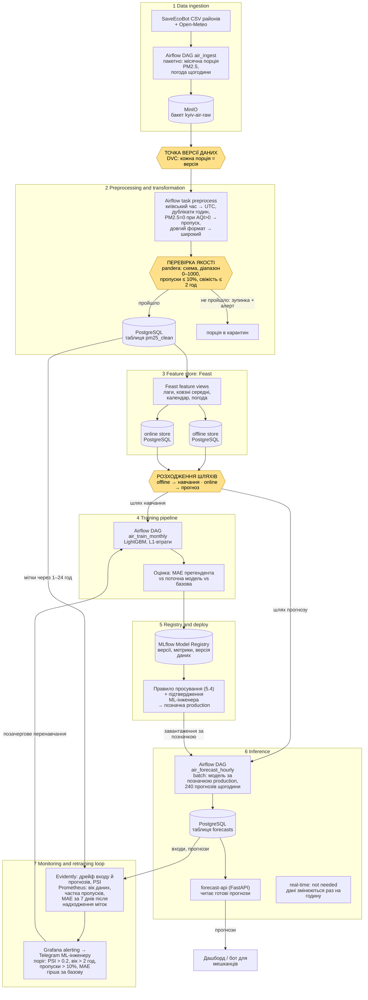
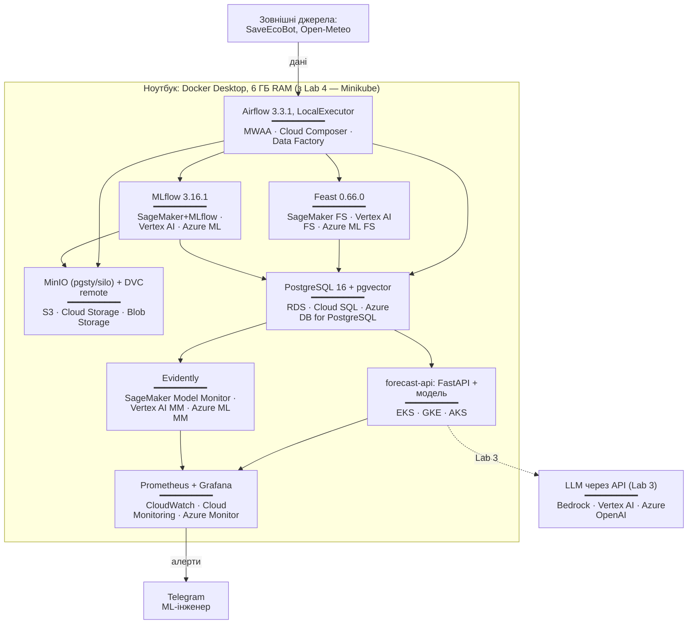

# Kyiv Air Forecast — Design Document

Прогноз концентрації PM2.5 на 24 години вперед для 10 районів Києва.
Документ ведеться за шаблоном ml-design-docs; нумерація розділів незмінна, бо наступні лабораторні посилаються на номери.

---

## 1 Overview

Мешканці Києва дізнаються про забруднене повітря лише тоді, коли воно вже забруднене: наявні мапи показують поточний рівень, але не наступну добу. Система щогодини прогнозує концентрацію PM2.5 на 24 години вперед для кожного з 10 районів міста на основі погодинної історії сенсорів SaveEcoBot і погодних даних. Прогноз порівнюється з нормативами ВООЗ і ЄС, які зберігаються в конфігурації окремо від моделі, тож зміна нормативу не потребує перенавчання. Бажаний результат: щонайменше 80% діб із перевищенням добового нормативу супроводжуються попередженням, виданим заздалегідь.

## 2 Motivation

**Хто споживає прогнози.** Мешканці районів через дашборд або бот із попередженнями (*Assumption:* реального замовника немає; споживачем вважаємо міський інформаційний сервіс на кшталт бота чи дашборда). Найбільше прогноз потрібен чутливим групам: людям з астмою, літнім людям, батькам малих дітей, тим, хто займається спортом надворі.

**Як часто.** Прогноз оновлюється щогодини; споживач читає його будь-коли протягом доби.

**Що буде, якщо прогноз хибний.**
- *Пропущене перевищення* (хибно негативний результат): людина планує прогулянку чи пробіжку на добу з брудним повітрям. Це найдорожча помилка.
- *Хибна тривога* (хибно позитивний результат): люди звикають ігнорувати попередження, і система втрачає довіру.

**Чому система, а не ноутбук.**
- Дані надходять безперервно, а якість повітря має сезонність (опалювальний сезон), тож модель старіє і потребує регулярного перенавчання.
- Сенсори відмовляють і зникають, тому потрібні автоматичні перевірки якості даних і моніторинг.
- Нормативи змінюються (директива ЄС 2024/2881 посилює ліміти з 2030 року), і система має реагувати без ручного втручання в модель.
- Прогноз потрібен щогодини автоматично, а не тоді, коли хтось запустить ноутбук.

## 3 Success metrics

Три рівні метрик тримаються окремо.

| Рівень | Метрика | Ціль | Тип |
|---|---|---|---|
| Бізнесова | Recall попереджень про добу з перевищенням 25 мкг/м³ (добове середнє, норматив ЄС) | ≥ 0.80 при precision ≥ 0.60 | satisficing |
| Модельна | MAE прогнозу PM2.5 (мкг/м³) по всіх районах і горизонтах 1–24 год на відкладеному періоді | щонайменше на 15% нижча за MAE базової моделі | optimizing |
| Системна | Свіжість: прогноз на годину H готовий не пізніше ніж о H:15 | ≥ 99% годин | satisficing |
| Системна | Затримка API, p95 | ≤ 300 мс | satisficing |

*Assumption:* цільові значення встановлено без реального замовника; їх буде переглянуто після першого навчання в Lab 2.

**Як рахується бізнесова метрика.** «Доба з перевищенням» — календарна доба, фактичне середнє PM2.5 за яку в районі перевищує 25 мкг/м³. «Попередження» — прогноз середнього на наступну добу, що перевищує той самий поріг. Recall = частка діб із перевищенням, для яких попередження було видано.

## 4 Requirements and constraints

### Функціональні вимоги

| Що | Опис |
|---|---|
| Вхідні дані | Погодинний PM2.5 для 10 районів Києва (SaveEcoBot); погода — температура, вологість, швидкість вітру (Open-Meteo); пороги нормативів (`configs/thresholds.yaml`) |
| Пакетна задача | Щогодини: завантажити нові дані → перевірити якість → побудувати ознаки → спрогнозувати 24 значення × 10 районів → записати в PostgreSQL |
| API | `GET /forecast?district=<slug>` — 24 погодинні значення, середнє за добу, прапорці перевищення для кожного нормативу, час генерації, версія моделі; `GET /health` — стан сервісу |
| Хто викликає | Дашборд або бот (*Assumption*, див. розділ 2) |
| Перенавчання | Щомісяця, коли надходить нова порція даних, або за алертом дрейфу |

### Нефункціональні вимоги

| Категорія | Вимога |
|---|---|
| Свіжість | Прогноз на годину H готовий до H:15. Якщо останні вхідні дані старші за 2 год, прогноз позначається як застарілий (`stale=true`). |
| Затримка і пропускна здатність | API: p95 ≤ 300 мс при навантаженні до 10 запитів/с (*Assumption:* один споживач). Пакетна задача: ≤ 10 хв на 240 прогнозів. |
| Доступність і запасний варіант | ≥ 99% під час демонстрації. Якщо модель недоступна, API повертає прогноз базової моделі з прапорцем `fallback=true`. Якщо даних району немає понад 6 год, API повертає 503 для цього району. |
| Відтворюваність | Середовище закріплене (`uv.lock`); дані версіонуються DVC; кожна модель у реєстрі MLflow має версію даних і коміт; той самий вхід дає той самий прогноз. |
| Адаптивність | Нові дані — помісячні порції. Нова модель замінює поточну, лише якщо її MAE на останньому місяці не гірша. Новий норматив додається в `configs/thresholds.yaml` без перенавчання. |
| Спостережуваність без міток | Мітки відомі лише через 24 год. До того стежимо за: віком останніх даних (алерт, якщо > 2 год); часткою пропущених годин (алерт, якщо > 10% за добу); дрейфом розподілу PM2.5 на вході (PSI > 0.2); дрейфом розподілу прогнозів. Після надходження міток — MAE за 7 днів порівняно з базовою моделлю. |
| Вартість і ресурси | Локально: ноутбук з 8 ГБ RAM, Docker ≤ 6 ГБ, тож компоненти не запускаються всі одночасно. LLM через API: ≤ $5/міс (*Assumption*). Хмарний варіант оцінено в розділі 6.7. |

### In scope

- PM2.5 для 10 районів Києва, горизонт 24 год, погодинно.
- Пакетний прогноз щогодини, API для читання готових прогнозів.
- Нормативи ВООЗ 2021 і ЄС 2024/2881 у конфігурації.
- Алерти про дрейф і застарілі дані для інженера.
- Текстовий корпус нормативних документів для LLM-компонента (Lab 3).

### Out of scope

- Інші забруднювачі (NO2, O3, SO2 тощо).
- Прогноз на рівні окремих станцій чи вулиць.
- Потокова обробка в реальному часі (Kafka, Spark).
- Мобільний застосунок і розсилка попереджень мешканцям.
- Автоматичний збір даних із сайту SaveEcoBot без ключа API.
- Медичні рекомендації.

---

## 5.1 Problem statement

**Постановка: прогнозування часового ряду як регресія.** Для кожного району d і кожної години прогнозу t модель передбачає концентрацію PM2.5 (мкг/м³) на години t+1, …, t+24. Використовується одна модель для всіх районів і всіх горизонтів (direct multi-horizon): район і горизонт h подаються як ознаки. Прогноз робиться щогодини; кожен запуск дає 240 значень (10 районів × 24 години).

Прогнозуємо саме концентрацію, а не індекс AQI. AQI NowCast — нелінійна функція від концентрацій за останні 12 годин, яку можна точно розрахувати з прогнозу концентрації. Пороги нормативів і AQI обчислюються після моделі з `configs/thresholds.yaml`.

**Відкинута постановка: бінарна класифікація «завтра буде / не буде перевищення».**
- Губить інформацію: 26 і 80 мкг/м³ стають однаковим класом «перевищення», а споживач не дізнається, наскільки все погано.
- Прив'язує модель до одного порогу: новий норматив (ЄС посилює ліміти з 2030 року) означав би нову розмітку й перенавчання, а тема вимагає підлаштування під нові регуляції.
- Перевищення — рідкісний клас, тож класифікатору бракуватиме прикладів.

Регресія дає і число, і будь-яку кількість порогів поверх нього.

## 5.2 Data

### Джерела

| Джерело | Що містить | Як отримуємо | Ліцензія |
|---|---|---|---|
| SaveEcoBot, погодинні дані районів Києва | `phenomenon` (pm25, aqi), `value`, `logged_at`; 10 файлів, по одному на район (ID 95–104, довідник у `configs/districts.yaml`) | Ручне завантаження CSV зі сторінок районів | CC BY 4.0, обов'язкове посилання на SaveEcoBot |
| Open-Meteo | Температура, відносна вологість, швидкість і напрям вітру, тиск для координат Києва | Безплатне API без ключа | CC BY 4.0 |
| Нормативи | Добові пороги PM2.5: ВООЗ 2021 — 15 мкг/м³, ЄС 2024/2881 — 25 мкг/м³ | Вручну в `configs/thresholds.yaml` | — |

PM2.5 у районі — це агрегат SaveEcoBot: середнє за годину по всіх станціях району, які працювали в цю годину.

### Як надходять дані

- Дані SaveEcoBot оновлюються щогодини: останній запис на момент завантаження — 09.11.2026, 02:00.
- **Порція = календарний місяць.** Історія завантажується один раз; місяці 2026 року подаються системі по одному як нові дані (Lab 2) і для спостереження за дрейфом (Lab 4).
- *Assumption:* поки немає ключа API SaveEcoBot, «живий» потік емулюється відтворенням порцій 2026 року. Автоматичний збір зі сторінок сайту без погодження заборонено умовами SaveEcoBot, тому система його не робить. Після отримання ключа змінюється лише шар завантаження (розділ 6.8).

### Мітки та їхня затримка

Мітка для прогнозу на годину t+h — фактичне значення PM2.5 у тому самому районі о t+h. Отже, мітка стає відомою через **h годин** після прогнозу, найпізніше через 24 години. Для бізнесової метрики (добове середнє) — через добу після закінчення цієї доби. До надходження міток моніторинг спирається лише на дрейф вхідних даних і прогнозів (розділ 4, рядок «Спостережуваність без міток»).

### Що доступно під час навчання і під час прогнозу

| Дані | Під час навчання | Під час прогнозу |
|---|---|---|
| PM2.5 районів до моменту t | Історія з CSV | Порція поточного місяця (емуляція); після отримання ключа — API SaveEcoBot |
| PM2.5 після моменту t | Є (це мітки) | **Немає** — тому жодна ознака не може брати значення пізніше за t |
| Погода на цільову годину | Архів фактичної погоди | Лише **прогноз** погоди |
| Календар, район, горизонт | Є | Є |

Розбіжність у погоді — відомий ризик для якості моделі (розділ 5.3).

### Формати зберігання

| Шар | Формат | Чому |
|---|---|---|
| Сирі дані | CSV у MinIO, як їх віддало джерело | Сирий шар не змінюється: файл має бути байт у байт таким, як його отримано, щоб будь-яку обробку можна було повторити. DVC версіонує файли, а не таблиці. |
| Очищені дані | Таблиця PostgreSQL `pm25_clean` | Нові години дописуються щогодини, а задачі читають вибірки «район × період»; база дає індекси за часом і районом, унікальність години (захист від дублікатів) і одночасний доступ кількох задач. |
| Ознаки | Таблиці Feast у PostgreSQL (offline і online) | Feast бере на себе узгодженість ознак між навчанням і прогнозом; одна база замість окремих сховищ економить пам'ять ноутбука. |

Parquet (стовпчиковий стиснутий формат) відкинуто для сирого шару, бо він уже не є «тим, що віддало джерело», а для очищених даних — бо ~350 тис. рядків на рік легко вміщаються в PostgreSQL, а дописування щогодини в Parquet незручне. *Assumption:* якщо обсяг зросте (більше міст чи забруднювачів), offline-сховище ознак буде перенесено в Parquet у MinIO.

### Відомі проблеми якості даних

Знайдено під час профілювання (09.11.2026); їх перевірятиме крок валідації даних у Lab 2.
- **Перехід на літній і зимовий час.** У звичайних роках 8759 годин замість 8760, у 2024 — 8782 замість 8784. *Assumption:* `logged_at` записано в київському часі; при обробці все переводиться в UTC, а дублікати години усуваються.
- **Нулі, що суперечать AQI.** У наборі міст трапляються рядки з PM2.5 = 0 при AQI ≈ 69. Такі значення вважаються збоєм і замінюються на пропуск.
- **Пропуски в 2026 році:** Оболонський — близько 93% годин, Подільський — 95%, Голосіївський — 97%; решта районів 99–100%.

### Обґрунтування за чеклістом даних

- **Часова вісь.** Кожен запис має погодинну мітку `logged_at`, і дані надходять безперервно. Порція — календарний місяць: у Lab 2 місяці 2026 року подаються по одному як «наступний місяць», а в Lab 4 дрейф виникає природно (опалювальний сезон, пропуски сенсорів). Ціна: потік емулюється відтворенням, а не надходить наживо.
- **Історія і відкладений період.** 10 районів, погодинний PM2.5 з 2019 року; використовуємо 2023–2026 роки з покриттям 99–100% у 2023–2025 і 93–100% у 2026. Період до 2023 року виключено свідомо: інший склад сенсорів, вторгнення й блекаути 2022 року — інший режим даних. Відкладений період — жовтень–грудень 2025 (розділ 5.4).
- **Мітки з відомою затримкою.** Мітка — фактичний PM2.5 через h годин, тобто відома не пізніше ніж через 24 години після прогнозу.
- **Текстовий корпус.** Чотири документи в `data/corpus/`, опис у `configs/corpus.yaml`: постанова КМУ №827 від 14.08.2019 про державний моніторинг атмосферного повітря; методика NowCast (US EPA) від SaveEcoBot; WHO global air quality guidelines (2021); директива ЄС 2024/2881 про якість атмосферного повітря.

## 5.3 Techniques

### Базова модель

**Сезонне наївне правило:** прогноз на годину t+h = фактичне значення в ту саму годину добою раніше, тобто PM2.5 о t+h−24. Оскільки h ≤ 24, це значення завжди вже відоме в момент t. Правило не потребує навчання і вловлює добовий цикл (ранкові та вечірні піки).

### Кандидат

**LightGBM-регресор**, одна модель на всі райони й горизонти, функція втрат L1 (відповідає метриці MAE). Причини вибору:
- добре працює з табличними ознаками часових рядів;
- сам обробляє пропуски (NaN), яких у сенсорних даних багато;
- навчається за хвилини на ноутбуці з 8 ГБ RAM;
- має важливість ознак, що пояснює прогноз на захисті й у моніторингу.

### Ознаки

Момент прогнозу — t, цільова година — t+h.

| Ознака | Опис | Звідки під час прогнозу |
|---|---|---|
| `district_id` | Район (категоріальна) | Запит / `configs/districts.yaml` |
| `horizon` | h = 1…24 | Задається пакетною задачею |
| `pm25_lag_0`, `_1`, `_2`, `_3` | PM2.5 району о t, t−1, t−2, t−3 | Останні записи порції поточного місяця (після ключа — API SaveEcoBot) |
| `pm25_same_hour_1d` | PM2.5 о t+h−24 (значення базової моделі) | Те саме джерело; завжди відоме, бо h ≤ 24 |
| `pm25_same_hour_7d` | PM2.5 о t+h−168 | Те саме джерело |
| `pm25_mean_6h`, `_24h` | Ковзне середнє за 6 і 24 год до t | Обчислюється з тих самих записів |
| `pm25_city_mean_0` | Середнє PM2.5 по 10 районах о t | Обчислюється з тих самих записів |
| `hour`, `day_of_week`, `month` | Календар цільової години | Годинник системи |
| `is_holiday` | Державне свято чи вихідний | Бібліотека `holidays` (Україна) |
| `heating_season` | Чи триває опалювальний сезон | `configs/heating_season.yaml` (*Assumption:* 15 жовтня — 15 квітня; реальні дати щороку оголошує КМДА) |
| `temp`, `humidity`, `wind_speed`, `wind_dir`, `pressure` | Погода на цільову годину | **Прогноз** Open-Meteo на t+h |

**Глибина історії для прогнозу.** Найдавніша ознака — `pm25_same_hour_7d` (до 167 год до моменту t), тому для прогнозу потрібні останні **7 діб** очищених даних PM2.5 з `pm25_clean` і прогноз погоди на наступні 24 години. Online-сховище Feast зберігає лише **останній рядок ознак на кожен район**, обчислений з цих 7 діб; рядок вважається дійсним 2 години (TTL), після чого прогноз отримує позначку `stale` (розділ 4). Offline-сховище зберігає всю історію ознак з 2023 року для навчання.

**Розбіжність між навчанням і прогнозом.** Під час навчання погода береться з архіву фактичних значень, а під час прогнозу — з прогнозу погоди, який сам має похибку. Модель, навчена на «ідеальній» погоді, переоцінює її надійність. *Assumption:* для зменшення розбіжності в Lab 2 буде перевірено [Open-Meteo Historical Forecast API](https://open-meteo.com/en/docs/historical-forecast-api), що зберігає архівні прогнози; якщо він покриває 2023–2026 роки, модель навчається саме на архівних прогнозах. Якщо ні, розбіжність лишається відомим ризиком (розділ 6.9), а її вплив вимірюється порівнянням MAE на фактичній і прогнозній погоді.

## 5.4 Experimentation and validation

### Поділ даних

Поділ лише за часом, без випадкового перемішування: інакше модель «бачила б майбутнє» через сусідні години.

| Період | Роль |
|---|---|
| 2023-01-01 → 2025-09-30 | Навчання |
| 2025-10-01 → 2025-12-31 | Відкладений період для вибору моделі та гіперпараметрів (опалювальний сезон, найскладніші умови) |
| 2026-01 → 2026-10 | Помісячні порції нових даних: перенавчання й порівняння моделей (Lab 2), дрейф (Lab 4) |

Між навчальним і відкладеним періодами залишається проміжок у 7 діб, щоб ознаки з тижневими лагами не використовували години з відкладеного періоду. Для підбору гіперпараметрів у межах навчального періоду використовується розгортальна перевірка за часом (expanding-window, 3 фолди по 3 місяці).

### Офлайн-метрика

- **Основна:** MAE (мкг/м³) по всіх районах і горизонтах 1–24 год.
- **Додаткові:** MAE окремо для горизонтів 1–6, 7–12, 13–24 год, окремо для кожного району і окремо для годин з фактичним PM2.5 вище 25 мкг/м³ (модель може покращитися на брудних годинах і погіршитися на чистих, не змінивши загальної MAE); recall і precision попереджень про добу з перевищенням 25 мкг/м³ (бізнесова метрика з розділу 3).
- Модель приймається, якщо її MAE щонайменше на 15% нижча за MAE базової моделі на тому ж періоді.

### Порівняння нової моделі з поточною

Щомісяця з надходженням нової порції:
1. Нова модель (претендент) навчається на всіх даних до кінця попереднього місяця.
2. Претендент і поточна модель оцінюються на щойно отриманому місяці, якого жодна з них не бачила.
3. Претендент замінює поточну модель, лише якщо:
   - його MAE не гірша за MAE поточної моделі;
   - MAE не погіршилася понад 10% у жодному районі;
   - recall попереджень не нижчий за 0.8.
4. Результат порівняння, версії даних і коду записуються в MLflow. Модель-переможець отримує в реєстрі MLflow позначку `production`.

## 5.5 Human in the loop

*Assumption:* в навчальному проєкті всі ролі виконує одна людина — автор проєкту як ML-інженер.

| Подія | Хто розглядає | Що робить |
|---|---|---|
| Алерт дрейфу або застарілих даних | ML-інженер (Telegram або e-mail) | Перевіряє, що сталося: збій сенсорів, зміна в джерелі чи справжня зміна режиму забруднення. Вирішує, чи потрібне позачергове перенавчання. |
| Просування нової моделі | Автоматичні умови з розділу 5.4 + підтвердження ML-інженера | Переглядає звіт порівняння в MLflow і вручну переводить позначку `production` на нову версію |
| Нове значення нормативу | ML-інженер | Оновлює `configs/thresholds.yaml` через коміт; модель не перенавчається |

**Як виглядає ручне втручання (override):**
- **Відкат моделі:** позначка `production` у реєстрі MLflow переводиться на попередню версію; сервіс підхоплює її без перевикладання коду.
- **Аварійне вимкнення моделі:** прапорець `use_baseline: true` у конфігурації переводить усі прогнози на базову модель; відповіді API отримують `fallback=true`.
- **Вимкнення району:** якщо сенсори району дають явно хибні дані, район позначається `enabled: false` у `configs/districts.yaml`, і API повертає для нього 503 з поясненням замість хибного прогнозу.

## 6.1 High-level design

Три діаграми використовують ті самі назви компонентів, що й розділ 6.2.

### Контекстна діаграма

Система — один блок; усе навколо належить іншим.

### Діаграма потоку даних (сім шарів)

Три обов'язкові позначки виділено жовтим: **точка версії даних**, **перевірка якості** і **розходження шляху навчання та шляху прогнозу**.

**Пропущених шарів немає.** Шар 6 реалізовано лише як batch; real-time-гілку позначено «not needed», бо PM2.5 оновлюється раз на годину і прогноз за запитом нічого не додає до пакетного (розділ 6.3).

### Діаграма розгортання (перша чернетка)

Локальний компонент → керований сервіс AWS / GCP / Azure. Lab 4 замінить цю діаграму реальною топологією кластера.

У кожному блоці над рискою — локальний компонент, під рискою — його відповідник в AWS · GCP · Azure. *Assumption:* локально не всі компоненти працюють одночасно через обмеження пам'яті (розділ 4, рядок «Вартість і ресурси»).

## 6.2 Infra

Локальний стек збігається з еталонною таблицею курсу (Додаток 3). Хмарні сервіси названо, але не використано.

| Компонент | Роль у системі | Локально | AWS | GCP | Azure |
|---|---|---|---|---|---|
| Об'єктне сховище | Сирі CSV (бакет `kyiv-air-raw`), артефакти MLflow, DVC remote | MinIO (`pgsty/silo`) | Amazon S3 | Cloud Storage | Blob Storage |
| Версіонування даних | Версія кожної місячної порції | DVC 3.67.1 + dvc-s3 | S3 remote | GCS remote | Azure Blob remote |
| Оркестратор | DAG `air_ingest`, `air_train_monthly`, `air_forecast_hourly` | Airflow 3.3.1, LocalExecutor | Amazon MWAA | Cloud Composer | Azure Data Factory |
| Перевірка якості даних | Перевірка схеми, діапазонів, пропусків, свіжості | pandera (бібліотека в задачі Airflow, окремого сервісу немає) | та сама бібліотека в MWAA | та сама в Composer | та сама в Data Factory |
| База даних | Таблиці `pm25_clean`, `forecasts`; сховище Feast; бекенд MLflow; pgvector (Lab 3) | PostgreSQL 16 + pgvector | Amazon RDS for PostgreSQL | Cloud SQL | Azure Database for PostgreSQL |
| Feature store | Offline-сховище для навчання, online-сховище для прогнозу | Feast 0.66.0 (обидва сховища в PostgreSQL) | SageMaker Feature Store | Vertex AI Feature Store | Azure ML managed feature store |
| Трекінг і реєстр моделей | Експерименти, версії моделей, позначка `production` | MLflow 3.16.1 | SageMaker with MLflow | Vertex AI Experiments + Model Registry | Azure ML with MLflow |
| Сервіс прогнозів | `forecast-api` (FastAPI): читає готові прогнози з `forecasts` | Docker-контейнер (з Lab 4 — Minikube) | Amazon EKS | GKE | AKS |
| Моніторинг моделі й даних | Дрейф входу й прогнозів (PSI) | Evidently | SageMaker Model Monitor | Vertex AI Model Monitoring | Azure ML model monitoring |
| Метрики й дашборди | Вік даних, пропуски, MAE, затримка API; алерти | Prometheus + Grafana | Amazon CloudWatch | Cloud Monitoring | Azure Monitor |
| LLM (Lab 3) | Відповіді на запитання про нормативи з корпусу | LLM через API (*Assumption:* vLLM на CPU з 8 ГБ RAM не запуститься) | Amazon Bedrock | Vertex AI generative AI | Azure OpenAI |

Зовнішні сервіси, якими система не володіє: SaveEcoBot і Open-Meteo (джерела), Telegram (канал алертів).

У Lab 4 додадуться Kubernetes-кластер (Minikube 1.33.1 → EKS / GKE / AKS) і реєстр контейнерів (вбудований у Minikube → ECR / Artifact Registry / ACR). Тоді вони з'являться і в цьому розділі, і на діаграмі розгортання.

## 6.3 Performance

**Рішення: пакетний прогноз щогодини, а не онлайн-прогноз за запитом.**
- PM2.5 оновлюється раз на годину. Прогноз, обчислений о 14:05, не зміниться до 15:00, хоч скільки разів його запитуй.
- Усіх можливих прогнозів лише 240 на годину (10 районів × 24 години), тож їх дешевше обчислити один раз, ніж на кожен запит.
- API лише читає готовий рядок із PostgreSQL, тому затримка не залежить від розміру моделі.

**Бюджет часу пакетної задачі** (повинна закінчитися до H:15, розділ 4):

| Крок | Бюджет |
|---|---|
| Завантаження нових даних і погоди | ≤ 3 хв |
| Обробка і перевірка якості (pandera) | ≤ 2 хв |
| Оновлення online-сховища Feast | ≤ 2 хв |
| Прогноз 240 значень і запис у `forecasts` | ≤ 2 хв |
| **Разом** | **≤ 10 хв** (запас 5 хв) |

**API:** p95 ≤ 300 мс при навантаженні до 10 запитів/с (*Assumption:* один споживач).
**Навчання:** щомісяця, ≤ 30 хв на ноутбуці (*Assumption:* близько 1,1 млн рядків навчальної вибірки: 10 районів × ~24 000 годин × горизонти з підвибіркою).

## 6.4 Security

- **Секрети:** паролі MinIO і PostgreSQL, токен Telegram-бота, ключ LLM API зберігаються у файлі `.env`, який внесено в `.gitignore`; у репозиторії лежить лише `.env.example` без значень. У хмарі — AWS Secrets Manager / GCP Secret Manager / Azure Key Vault.
- **Хто може викликати сервіс:** `forecast-api` лише читає дані, змінювати їх через API неможливо. Споживач передає ключ у заголовку `X-API-Key`. *Assumption:* один ключ для одного споживача.
- **Мережа:** MinIO, PostgreSQL, Airflow і MLflow доступні лише всередині Docker-мережі; назовні відкрито тільки порт `forecast-api`.
- **Ключ API SaveEcoBot** (коли буде отриманий) — теж секрет у `.env`.

## 6.5 Data privacy

- **Персональних даних немає.** Набір містить погодинні значення PM2.5, усереднені SaveEcoBot до рівня району. Рівень району обрано зокрема тому, що дані окремих приватних сенсорів можуть вказувати на адресу власника сенсора.
- **Погода й нормативні документи** — відкриті дані без персональної інформації.
- **Логи API** не зберігають IP-адрес споживачів, лише район, час, статус і затримку.
- **Ліцензія:** дані SaveEcoBot — CC BY 4.0; посилання на SaveEcoBot є в README і поруч із кожним відображенням прогнозу. Open-Meteo — CC BY 4.0.
- **Строк зберігання:** сирі дані та їхні версії в DVC — увесь час існування проєкту (потрібні для відтворюваності); таблиця `forecasts` — 90 днів; логи — 30 днів.

## 6.6 Monitoring and alarms

Перша чернетка; Lab 4 зробить її реальною.

**Що логуємо:**
- кожен запуск DAG: кількість завантажених рядків, результат перевірки pandera, тривалість кожного кроку, версія даних (DVC) і моделі (MLflow);
- кожен запит до API: район, статус, затримка, версія моделі, прапорці `stale` і `fallback`;
- кожен прогноз: вхідні ознаки, значення і `input_max_logged_at` — час останнього запису PM2.5, на якому його побудовано (у таблиці `forecasts`); це потрібно для порівняння з мітками й для перевірки, що прогноз зроблено на нових даних.

**Метрики, пороги й отримувач алерту:**

| Метрика | Інструмент | Поріг спрацювання | Отримувач |
|---|---|---|---|
| Вік останніх даних PM2.5: зараз мінус max(`logged_at`) у `pm25_clean` | Prometheus | > 2 год | ML-інженер, Telegram |
| Вік останнього прогнозу: зараз мінус max(`generated_at`) у `forecasts` (ловить випадок, коли задача не запустилася або нічого не записала) | Prometheus | > 75 хв | ML-інженер, Telegram |
| Вік даних, на яких побудовано прогноз: зараз мінус `input_max_logged_at` останнього прогнозу (ловить випадок, коли задача «успішна» й пише нові прогнози, але щоразу читає ту саму порцію даних) | Prometheus | > 2 год | ML-інженер, Telegram |
| Частка пропущених годин за добу (по району) | Prometheus | > 10% | ML-інженер, Telegram |
| Порція не пройшла перевірку pandera | Airflow | будь-яке падіння | ML-інженер, Telegram |
| Дрейф розподілу PM2.5 на вході, тиждень проти навчальної вибірки | Evidently | PSI > 0.2 | ML-інженер, Telegram |
| Дрейф розподілу прогнозів | Evidently | PSI > 0.2 | ML-інженер, Telegram |
| MAE за останні 7 днів (коли надійшли мітки) | Prometheus | гірша за MAE базової моделі за той самий період | ML-інженер, Telegram; позачергове перенавчання |
| Затримка API, p95 | Prometheus | > 300 мс протягом 10 хв | ML-інженер, Telegram |
| Частка відповідей з `fallback=true` | Prometheus | > 5% за добу | ML-інженер, Telegram |
| Справність самого моніторингу: щоденне повідомлення «моніторинг працює» (heartbeat) і алерт Grafana на стан «No data» для будь-якої метрики | Grafana | heartbeat не надійшов до 09:00; метрика без даних > 30 хв | ML-інженер, Telegram |

Тиша в Telegram не означає, що все гаразд: зламатися може й сам моніторинг (зупинився Prometheus, протермінувався токен бота). Тому моніторинг щодня надсилає контрольне повідомлення, і його відсутність — теж сигнал.

## 6.7 Cost

Оцінку зроблено в AWS Pricing Calculator 10.11.2026: [збережена оцінка](https://calculator.aws/#/estimate?id=fdc52caad47caea529d4571dcec70aaecfa45607). Регіон us-east-1, ціни On-Demand без довгострокових зобов'язань.

| Сервіс AWS | Конфігурація в калькуляторі | $/міс |
|---|---|---|
| Amazon MWAA | Small environment, 1 воркер, 2 вебсервери, 2 планувальники, 1 ГБ метаданих; працює постійно | 357.80 |
| Amazon SageMaker (MLflow) | 1 Small tracking server, 24 год × 30 днів, 1 ГБ сховища | 432.10 |
| Amazon EKS | 1 кластер, Standard support | 73.00 |
| Amazon EC2 (вузли EKS) | 2 × t3.medium, Linux, On-Demand, 100% часу, 20 ГБ gp3 на вузол | 63.94 |
| Amazon RDS for PostgreSQL | db.t4g.micro, Single-AZ, On-Demand, 20 ГБ gp3; без Database Insights і RDS Proxy | 13.98 |
| Amazon CloudWatch | 20 метрик, 10 алертів, 1 ГБ логів | 7.50 |
| Amazon S3 | 5 ГБ S3 Standard, 10 000 запитів запису й читання | 0.17 |
| **Разом за калькулятором** | | **948.49** |

Поза калькулятором (*Assumption*, разом ≤ $6/міс): Amazon Bedrock для LLM-компонента (≤ $5), SageMaker Feature Store (< 1 ГБ, ~175 тис. записів і читань, ~$1), SageMaker Model Monitor (щоденна перевірка в межах 30 безплатних годин на місяць, $0).

**Припущення оцінки:**
- усі сервіси працюють цілодобово (730 год на місяць; MLflow — 720 год);
- On-Demand: зобов'язання Savings Plans на 1–3 роки знизили б вартість вузлів EC2 приблизно на 60%, але для навчального проєкту, що може змінитися за місяць, вони не підходять;
- Single-AZ для бази: Multi-AZ подвоїв би її вартість заради відмовостійкості, яка демонстраційній системі не потрібна;
- трафік між сервісами й назовні нульовий (240 прогнозів на годину — кілобайти).

**Висновок з оцінки.** 83% вартості ($790 з $948) дають два сервіси, що працюють цілодобово, хоча мають роботу кілька хвилин на годину: MWAA і MLflow. Дешевший варіант: Airflow і MLflow як контейнери в тому самому кластері EKS. Тоді загальна сума знижується приблизно до $160–190 на місяць (можливо, знадобиться третій вузол t3.medium, +$32), але адміністрування стає власним обов'язком. Для такої малої системи це виправдано.

Окреме спостереження: калькулятор за замовчуванням увімкнув для RDS платні опції Database Insights ($18.25) і RDS Proxy ($21.90), що збільшило оцінку на $40 (+4%). Ці опції вимкнено, бо моніторинг бази покривають Prometheus і Grafana, а клієнтів у бази кілька, а не сотні.

## 6.8 Integration points

**Постачальник даних: SaveEcoBot (ГО «SaveDnipro»).**
- *Формат:* CSV з колонками `phenomenon`, `value`, `logged_at`; файл на район; ID району в назві файлу (`configs/districts.yaml`).
- *Частота:* дані оновлюються щогодини; система отримує місячну порцію.
- *Умови:* CC BY 4.0, обов'язкове посилання; систематичний автоматизований збір зі сторінок без погодження заборонено. Заявку на ключ API подано (*Assumption:* ключ надійде до Lab 4; якщо ні, потік емулюється порціями 2026 року).
- *Що, якщо контракт порушено:* зміну схеми або формату дат ловить перевірка pandera на вході шару 2; порція не потрапляє далі, надходить алерт.
- *Довідник районів:* SaveEcoBot його не публікує; відповідність ID ↔ район ведеться вручну в `configs/districts.yaml`.

**Постачальник погоди: Open-Meteo.** JSON API без ключа; *Assumption:* безплатний тариф для некомерційного використання покриває 24 запити на годину з великим запасом.

**Споживач прогнозів: дашборд або бот** (*Assumption*, розділ 2).
- *Контракт:* `GET /v1/forecast?district=<slug>` → JSON: `district`, `generated_at`, `model_version`, `hourly` (24 значення PM2.5, мкг/м³), `daily_mean`, `exceeds` (прапорець для кожного нормативу), `stale`, `fallback`.
- *Обіцянка свіжості:* прогноз не старший за 75 хв, а вхідні дані для нього — не старші за 2 год (розділ 4); якщо будь-яку з умов порушено, відповідь має `stale=true`, а не мовчки віддає старі дані.
- *Зміни контракту:* нова версія API за шляхом `/v2`, `/v1` працює ще щонайменше місяць.
- *Обов'язок споживача:* показувати посилання на SaveEcoBot як джерело даних.

## 6.9 Risks and uncertainties

| Ризик | Захід |
|---|---|
| SaveEcoBot змінює формат CSV або назви колонок | Перевірка pandera на вході шару 2 зупиняє порцію й надсилає алерт |
| Сенсори району відмовляють (пропуски, нулі) | Нулі при AQI > 0 → пропуск; LightGBM працює з пропусками; при > 6 год без даних API повертає 503 для району |
| Ключ API SaveEcoBot не надійде | Емуляція потоку порціями 2026 року; змінюється лише шар завантаження, решта системи без змін |
| Розбіжність погоди: навчання на фактичній, прогноз на прогнозній | Навчання на архіві прогнозів Open-Meteo (перевірка в Lab 2); якщо недоступно — вимірюємо вплив і фіксуємо в 7.2 |
| Перехід на літній / зимовий час дублює або губить години | Переведення в UTC на кроці обробки, перевірка унікальності годин у pandera |
| Нестача пам'яті ноутбука (8 ГБ) | Docker ≤ 6 ГБ; компоненти запускаються по черзі; Feast і MLflow на спільному PostgreSQL |
| Зміна нормативу (ЄС 2030, нові українські правила) | Пороги в `configs/thresholds.yaml`, модель не перенавчається |
| Зміна режиму забруднення (опалювальний сезон, пожежі, обстріли) | Моніторинг дрейфу (PSI) і щомісячне перенавчання; при різкій зміні — позачергове |
| Хибна відповідність ID районів у довіднику | Перевірено вручну на сторінках районів 09.11.2026; ID записані в конфігурації в Git |
| Вартість хмари недооцінена | Оцінку зроблено в AWS Pricing Calculator з переліченими припущеннями; запасний варіант — самостійно розгорнуті MLflow і Airflow (розділ 6.7) |

## 7.1 Alternatives

| Альтернатива | Плюси | Мінуси | Чому відкинуто |
|---|---|---|---|
| **Постановка:** класифікація «буде / не буде перевищення» | Пряма відповідь на бізнесове запитання; простіша метрика | Губить рівень забруднення; прив'язує модель до одного порогу; мало прикладів класу «перевищення» | Тема вимагає підлаштування під нові нормативи; регресія дає будь-які пороги без перенавчання (5.1) |
| **Архітектура:** потокова обробка (Kafka + Spark) | Відповідає формулюванню теми «real-time streaming»; затримка секунди | Значно складніша; не вміщається в 8 ГБ RAM разом з рештою; дані оновлюються раз на годину | Щогодинний пакет дає ту саму свіжість прогнозу значно простіше (6.3) |
| **Дані:** набір SaveEcoBot на data.gov.ua (міста, CC BY) | Офіційний відкритий набір; повна історія з 2019 року | Лише рівень міста; останні дані — 31.12.2025 | Немає районів і 2026 року; залишено як запасне джерело історії |
| **Дані:** щоденні спостереження УкрГМЦ (data.gov.ua, meteo.gov.ua) | Державні еталонні пости; кілька забруднювачів | Публікація із затримкою 1–2 місяці; лише щоденна деталізація; пропуски днів; змішані формати XLS / XLSX / CSV | Без свіжих даних неможливо будувати ознаки для прогнозу; можна використати для звірки з еталоном |
| **Дані:** набір КМДА «Дані оцінки якості повітря» | Офіційні станції міста; 6 забруднювачів; JSON API | Історія лише з 26.03.2026; крок 3 години; інші прилади, ніж у SaveEcoBot | Замало історії для сезонності; можливе розширення на інші забруднювачі, коли історія накопичиться |
| **Моделі:** окрема модель для кожного району | Кожна модель налаштована під свій район | 10 моделей для навчання, версіонування й моніторингу; менше даних на модель | Одна модель з ознакою району простіша в обслуговуванні й бачить спільні закономірності міста |

## 7.2 Experiment results

_Placeholder: заповнюється в Lab 2._

## 7.3 Monitoring results

_Placeholder: заповнюється в Lab 4._

## 7.4 Milestones

- **Lab 2:** дані й навчання стають автоматичними й відстежуваними: DAG Airflow завантажують місячні порції в MinIO з версією в DVC, pandera перевіряє якість, Feast наповнює ознаки, базова модель і LightGBM навчаються з записом у MLflow, тести додаються в CI, а результати заповнюють розділ 7.2.
- **Lab 3:** додається LLM-компонент, що через пошук у pgvector по корпусу нормативних документів відповідає на запитання на кшталт «що означає прогноз 32 мкг/м³ для Подільського району за нормами ВООЗ і ЄС», разом з оцінкою якості відповідей.
- **Lab 4:** `forecast-api` розгортається в Minikube, Evidently, Prometheus і Grafana стежать за дрейфом на відтворених порціях 2026 року, алерти йдуть у Telegram, а результати заповнюють розділ 7.3 і нову діаграму розгортання.
- **Lab 5:** агент отримує доступ до системи як до інструментів (прогноз через `forecast-api`, нормативи через LLM-компонент) і відповідає на запитання користувача про якість повітря в районі.
